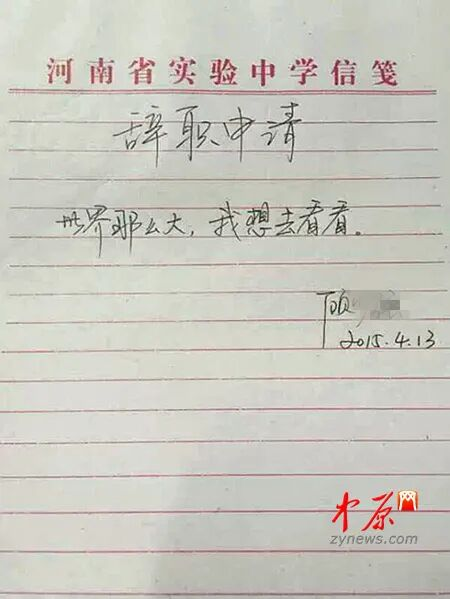
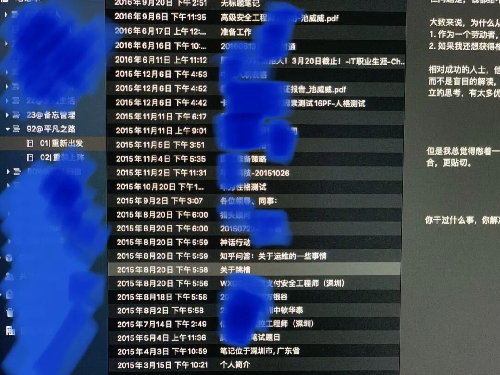

最近一段时间经常失眠，夜里碾转反侧，回想自己信安之路一直走来，患得患失。

**01**

**不安分**

说起信安，是一种缘分，2010年刚毕业时候拿的第一份工作是一家做安全测评的安服公司W，那时候的安全还没那么火，也想不清楚自己以后到底要走什么路。只记得在W公司拿了一个月的工资，2400。

因为那时候的自己缺少职业规划，于是在家人的一轮又一轮的劝说下就去了一家国企T，做了一个网络运维，于是离职了W，成为人生第一次跳槽。

在国企T一待，就是5年， 拿了几个网络paper证书，结了婚，生了娃，一切似乎都在按部就班的进行着。

五年国企的工作不能说不好，最可怕的事情是，那个时候的我已经看到未来二十年甚至三十年后的自己，生活就会像 “接着我会....，然后....，接着...，如果这样，就会.....，也可以这样.... ”这样排好版，就像一段已经写好的代码，顺序执行，直至退休终老、结束。

其实，如果这段代码不出BUG的话，或许也是很多人梦寐以求的吧。

那几年，有两个事情特别让我触动：

1.   父亲，年近60多了，开始学会用了小米盒子找他喜欢看的电视剧；

2.  2014年前后，移动互联网趋势正剧烈的改变我们的生活方式，例如：微信红包、移动支付。

互联网技术以更彻底的方式在改变我们的生活，用现在的话来讲就是“风口”。

T公司是一个传统的电视运营商，传统的思路也很难让其参与到整个技术潮流中，就像小米盒子正悄悄的改变了人们观看电视习惯，当一个中老人都能够熟练互联网产品的时候，未来的新新人类更不可能还像我们小时候一样天天看着电视，注定是一个夕阳产业。更不用说移动互联网的发展了。

对外面的世界充满好奇，每一个IT技术理念的革新都让我激动不已，那时候的我就像一个关在笼子的孩子，通过一个小小的窗口，看着外面的技术世界潮涌澎湃，自己却无法参与其中。

恰巧那一年有一位老师的辞职信火了：“世界那么大，我想去看看”。

一语击中的感觉，没有那句话可以比这句更能体现当时我内心的感受了，这是促使我离职最后一根稻草。

那时候的父母特别不理解，在他们眼中，“稳定”的工作比什么都重要，我这一“出去”，就真的要“颠沛流离”了。

也许，没看过外面的世界，我心中还是有那么一点不甘心、不安分。过程很艰辛，但即使头破血流，也好。

**02
**

**重新出发**

既然做好决心离开，首先要确定的就是方向。

前五年一直是做路由交换的网络运维，还是兼任着的网络安全的工作。有一次，无意发现公司对外开放的一台设备上直接暴露了后台，存在上传文件漏洞，那时候好奇，就验证了一把漏洞的实现。验证完之后，特别感慨，惊讶于原来还有这么骚的操作来突破防火墙，才知道安全的门道比之前想的都要深，绝不是仅仅一台防火墙就能搞定的事情。

这也算是我最早接触的安全，很简单，但也强烈触发我内心的渴望，特别想多去见识和了解更多的攻击技术，于是当最后一根稻草落下的时候，我毅然选择往安全方向走。

“互联网+安全”是我当时的决定和目标。即使五年后的今天回顾看来，这个决定没有一点点后悔，甚至是庆幸的。

于是，有了大学毕业以后的有一次真正为了自己未来的计划和行动，我为这次行动取了一个代号——“重新出发”。

要从一个安逸环境出来，对我来说是一个坎，一是心里上要有足够的预期来应对接下来可能会漂泊几年风险，二是要从技术层面提升，最起码要达到互联网公司可接受的最低技术要求。

白天上班，晚上看书，是那段时间的常态，如果说在之前考证是为了一张paper看书，很简单，你所遇见的问题是规定好的，勤奋点，多记点就OK，如果为了跳槽看书，尤其是面对之前没有接触的领域跨行业跳槽，那种茫然又不知所措的感觉，会让你不安。

那时候学习，主攻安全，也啃linux啃运维，什么白帽讲web安全、Web实战、白帽子讲Web安全、渗透测试指南、Linux运维、Python基础教程等等啃了一遍，开始一点一点去梳理自己的知识体系。

一边啃书，一边投简历，一边开始准备面试，那时候投简历投的很泛，只要跟安全运维相关的，都投，只要有面试机会，就去，培训机会也不放过，设置连CISSP也去脱产培训了一轮。毕竟，那时候心太虚了。

印象最深的是那年呆神搞了一个“神话行动”，也报名参加了，还特地为了一个半天的面试机会飞了一趟北京，那是我长那么大第一次去北京... 当然那次没有入选，如果入选了现在的我可能就有很大不一样了。

那段时间是人生第一个“至暗时刻”，基本上把招聘APP上能面的岗位都面完了，还没面上一个。

没有“选择权”，只有“被选择”。

△那些年的一些面试笔记

**03**

**销售？**

在面了几个月后，终于有一家小公司Z要了我。那是一个只有10个人的小安全公司，主要卖很小众的主机安全产品。记得那时候入职前老板还让我写了一篇对未来的工作安排设想，来判断我是否适合那个岗位，那时候还是很真的认真写了自己的宏伟蓝图。现在想想，举动有点傻，但很虔诚的珍惜一次来之不易的机会。即使没有达到我想要去的互联网公司，起码能够跳出来，也算是踏出了第一步。

Z公司虽小，但老板能力很强，通过各种关系搞定了行业内的客户。

入职的岗位，真的就是一个打杂的，除了不用去客户那装机外，其他的活都是我的，甚至那年中秋节被老板吩咐开着车去批发市场帮忙拉水果，然后在当天晚上的某行业领导的饭局上，招呼客户、把水果用小推车一一送到各客户的车上。

那时候行业内做的那些安全项目只是为了应付检查，公司在向客户做安全方案的时候，会特别夸大主推产品的能力，让人感觉买了这个产品就安全无忧。说实话，这些营销技术很好，尤其是对那种不差钱又缺乏一定安全能力的政企客户，再加上关系硬，钱花哪不是花呢。对于我来说，安全不仅仅是这样的，这与我理想的工作也相差甚远。

我只想安安心心做一个技术宅，什么销售、什么应酬、什么局长之类的，心里是抗拒的，也与我的目标差距很大。

于是，我选择了离开，接着准备下一个公司X面试。

在这个公司共待了3个月，90天。意味着第一次跳槽的失败。

**04**

**愣头青
**

在下一家公司X面试之前，花了1个月准备，还特地邀请一名比较资深的安全老师给我培训了一番，是专门的一对一的面试培训。现在想想，那时候是心里太虚了，再加上首次跳槽的挫败，能不能面上，心里一点底都没有。

还好，最后还是面上了，不用做“销售”，让我欣慰很多。

X公司是一家银行，由于急于逃离，所以入职的时候是一个外包的身份。外包最难以忍受的是做同样的事情，待遇差了一大截，每次看正编发福利都是大包小包，而外包却只能干瞪眼。这种与之前国企的落差，恍如隔世，所以当时就认定，这只是一个过渡，要想办法找一个更好的工作。于是瞄上了另外一家互联网公司C，但这次，我没有马上投简历，而是一直暗暗准备着。

动手实践，是在这家银行最大的收获。那时候有幸得到领导信任，独立搭起了一套日志收集分析系统，让我受益匪浅。现在看起来，哪系统也没啥高大上的，无非就是一个ELK系统。但对于当时我的来说，是开了一个新世界，从日志系统选型、开发、配置、部署到Python、ELK、Kafka、Flume、Hadoop技术知识积累，都手把手操作一遍以后，才有一个感性的认识。记得那时候Python还不会使用try excep抓取报错，报错全用if else一个个排除；也不会用IDE，全靠vim写，执行一下看下错误，vim进去改一下，如此反复；办公室也不让上外网，就把ES整个doc文档离线下来；最疯狂的时候在办公室码了快36小时代码，让我那几个星期见到Python就感觉吐血.....

那段时间应该是我工作几年以后第一次打满鸡血的时光，每天恨不得都在办公位上去完成既定的任务目标。现在回想，那时候全凭着蛮力在干，和搬砖的没啥两样，最最关键的是，最后做什么什么样，其实自己心里没底，反正干就对了。后来，小成果也是有的，最起码，那个小小预期的目标还是实现，简单的日志分析告警展示功能还是有的嘛。

只不过后来，领导调整了，整个小组的重心调整了，不能再好好码代码了，不能把所有精力都投到这个项目了，也未能及时给我转正编，有点心塞，于是，我知道之前计划的安排，也该去落地了。

**05
**

**选择**

经过快半年的准备，最后还是拿到了C公司的Offer。

还记得C公司最后一面结束后，坐在C公司楼下，缓了好久才缓过来，那次面试真的使劲全力；

就在我入职C公司后一周后，非常神奇的，也收到了HW的Offer，幸福来的太突然了。

其实对待HW的面试，我也很谨慎的，也做了很多的功课，毕竟HW还是一个大厂，而且面试HW前前后后也面了三轮，有一轮最后都是卡在最后的心里测试上。

相比起C公司，HW还是让我多一点点顾虑，一是自己更憧憬互联网公司的文化；二是当年很火的狼性文化对我来说，还是有点点胆怯，这不是说我没有“奋斗者精神”，而是更希望这种“奋斗者精神”是发自自己的内心，而非靠制度靠规则来约束，没有任何东西会比内心的渴望更能让人“奋斗”。

**“**

**选择比努力重要**

**行业比公司重要**

**能力比金钱重要**

**与什么人共事比做什么事重要**

**既要埋头干活，也要抬头看路**

**耐得住寂寞，经得起诱惑**

**勿忘初心，不要后悔。**

**——记一次抉择**

**”**

这是当时发在朋友圈鼓励自己的一段话。

回想起2016年，这个抉择是我觉得那几年自己做过最牛逼的事情。这倒不是HW不好，而是第一次让我感受了到能够选择的权利，也算是对自己那段时间努力的最好的回报和肯定。

**06
**

**上岸**

在C公司，主要是做主机安全检测，主要做内部安全检测，也兼顾一点乙方的基线检测产品输出。

自由是C公司一大特点，由于安全老大是从BAT出来的，所有C公司算是一个比较小的BAT生态。

做了边界防护、信息泄露检测、漏洞检测、基线检查的产品，内部流程建设。做的内容不多，但每一项都花了好多时间去做，算是比较细致。

印象最深的是做边界风险检测，前前后后花了1年多的时间；可能有人会问了，不就是一个端口扫描嘛，至于做那么久吗，是不是你能力太菜了？是的，当初我也是这样简单认为一个扫描脚本的脚本的事情太简单了（当然，当时我或许的确也是比较菜... ）。但是在做这个事情的过程中，给我最大的感受是，做成一件事情，做到30分、60分和90分是有很大区别的，如果要做到99分、甚至100分，需要花费的时间是指数级增长的。

例如，就扫描这个事情，大致有以下功能要点：

-       扫描脚本

-       扫描策略

-       速率、时效性

-       覆盖率

-       关联资产

-       自动告警

-       关联流程

-       主动处理

-   ........

上述这些还只是部分功能点，还有一些性能指标要求，还不包括在实际过程中遇到的各种坑，例如“资产关联”这一项就可以折腾死，在“CMDB准确性一般”的情况下去保证资产信息关联的准确性是一个很大的挑战。所以，如果你认为端口扫描很简单，那只看到“扫描脚本”这一个功能项，当要落地到实际运营的时候，仅仅一个“扫描脚本”是没有办法闭环的。安全运营是一项没有终点的工作，只看你要达成怎样的效果。

在C公司算是一个成长非常快的过程，起码单纯的安全防护理念在企业的落地情况算是有了。遗憾的是，一直都没有接触到攻防实战，这也是当前感觉最薄弱的点。

在C公司安全老大也是我见过最nice的老大，能力强，从不给下属画饼，有一说一，也是真心为了下属考虑问题的老大。（为了避嫌，就不多说了.... ）

在C公司就职有3年，曾经甚至有想过在C公司养老的冲动。促使我离职的，一是感觉自己遇到了瓶颈，似乎很难突破，其次，还是看看外面的世界，说起养老，还真没那么快考虑。

现在回想起来，有些瓶颈可能未必真的存在，只是自己想多了就存在了，也可能自己不善言语，缺乏了沟通导致一些误解。

所以，直到离职那一刻，在心里只是不舍与矛盾。

**07
**

**重装上阵**

下一家，第一次看到JD，没啥感觉，就试探下的心态投的简历，一是当初并没有非常迫切的想跳，二是想着练练手。意想不到的是，面试结果还是比较顺利的，这是毕业以来，面试最轻松的，更没有像之前那样提前好几天开始准备面试工作。

阴差阳错之下，就答应了，于是，就来了。

**08**

**十年**

想想自己大学毕业至今快十年了，如果十年前让我来想象现在的生活，是肯定无法想象的，尤其魔幻的2020年，魔幻到居然可以在家办公3个多月，魔幻到每个人出门要带口罩，魔幻到孩子的寒假几乎可以和暑假连着放，魔幻到中美之间各种战，魔幻到整个世界格局都在剧烈变革... 十年来，真的改变了很多。

十年来，真正入坑信安有5年了；作为从事信息安全网络安全的人，我不是特别聪明，与其他大牛动不动就日站、打CTF、拿CVE、挖0Day相比，我真的菜到不能再菜了。但我希望自己可以一点点走下去，即使很慢很长，即使被各位大佬的技术按到地上摩擦摩擦...  能够安安静静为了自己想做的事情一点点做下去，也算是自己的小确幸吧。

这些年做的那么多决定，有些决定所带来的收益不尽人意，但也没什么好后悔的。在投资领域有一个“认知变现”概念，就是说“**你所赚的每一分钱都是你对这个世界的认知变现，你所亏的每一分钱都是因为对这个世界认知有缺陷**”。同理，在自己人生要走什么路所做的抉择，也一样取决于当时的认知水平，因此，如果要怪路没走好，只能怪自己见识太少，对这个世界认知缺陷太多。

十年来，对技术积累感觉一直很虚，倒不是自己没花心思，也稀稀拉拉总结了一些东西，但现在看来是缺少一种系统化的提炼与思考，总感觉是是而非。刚毕业那会就想着输出点技术文，之前注册的博客就注册那天登录过，也可能自己强迫症厉害，非要把技术的东西准备着很完美才输出，这样的结果就是永远都没有“完美”那一刻，于是，永远都没有办法输出。印象笔记收藏的很多待学习的文章，真正自己输出的内容却很少。一览而过技术文，并没有真正转化成自己的内在的知识，这种诟病是应该改一改了。

这辈子，我估计都会是一个技术宅吧，那就安安静静做一个安全的技术宅好了，那就从“了解一个技术，实现一个Demo， 输出一篇文章”开始吧。

**“**

**你不需要很厉害才开始，但你需要开始，才会变得很厉害。**

**”**

我很菜，但要“开始”。技术的东西，从“知道”到“做到”还是有一段距离的，最重要的是“开始”，只有“开始”才会真正让你变得厉害起来。

“

**种一棵树最好的时间是十年前，而后是现在。**

”

既然错过了十年前，那就抓住现在吧，开始写公众号，强迫自己输出，愿在十年后，可以有一个更好的自己。

以上是为十年小记，是为“信安小记”—— 序。

---

*本文首发于微信公众号「安小记」，[原文链接](https://mp.weixin.qq.com/s/oy7tJgV0kJzjm7iPwCK0wA)。*
