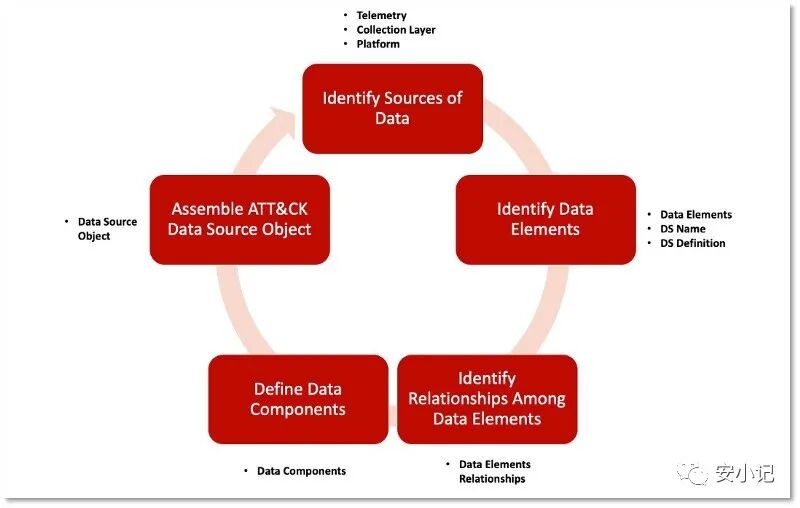
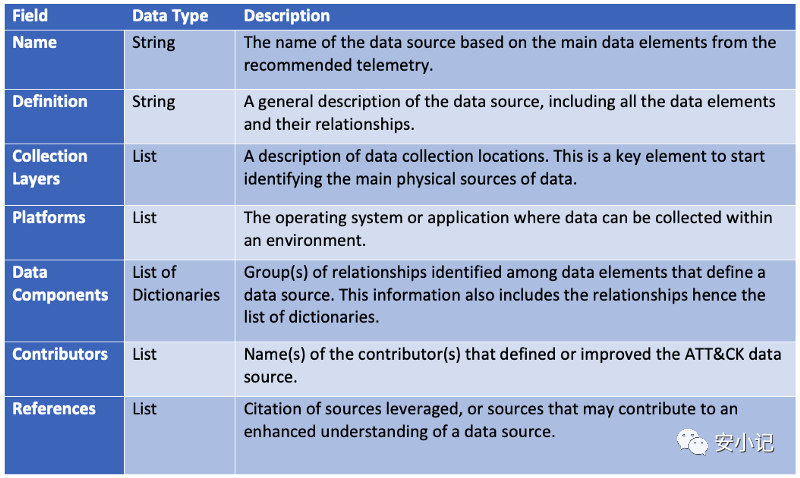
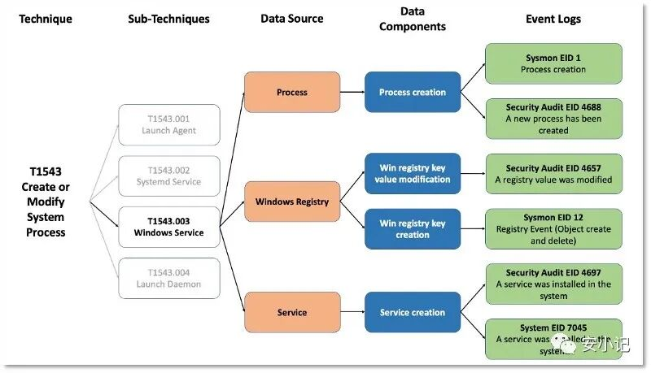
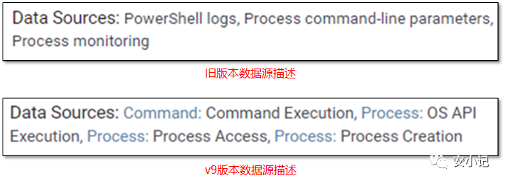
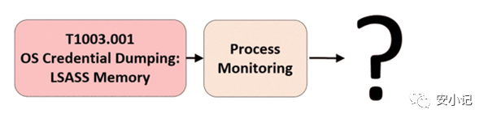
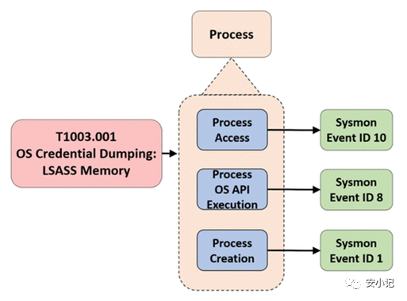
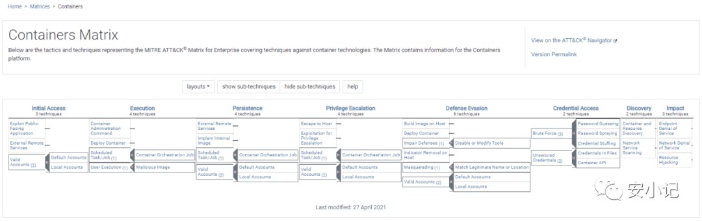
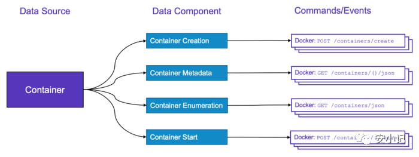
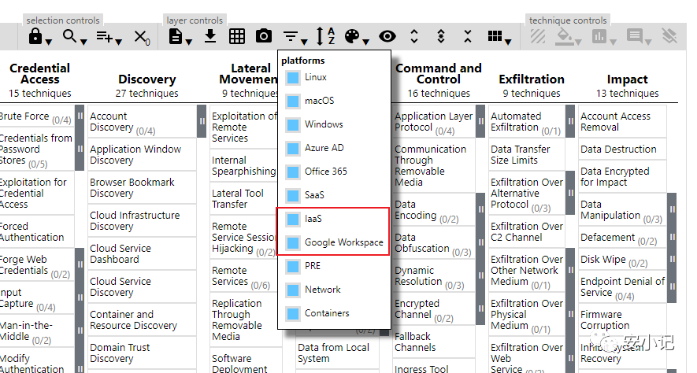

MITRE ATT&CK 于4月29日发布v9版本更新，此次更新数据源、容器、云等方面内容，上次更新还是在2020年10月，这次就直接跳到v9大版本了。

（如果还不了解ATT&CK，可以翻看本公众号之前几篇文章）

本次主要更新内容：

1.  更新：数据源更新，（1集，2集 ？）

2.  更新：对macOS技术更新


3.  新增：整合IaaS平台

4.  新增：Google Workspace平台

5.  新增：新增容器相关技术点，ATT&CK for Containers

MITRE ATT&CK 此次更新了*Enterprise*、*Moblie*、*ICS*的技术、组和软件。最大的变化是对数据源描述重新修改，还增加了*Containers*和*Google Workspace*平台，并用单个*IaaS*平台代替*AWS*, *Azuer*和*GCP*平台。此次更新了16个新组，67个新软件，36个组和51个软件条目。更新之后，技术总数达到了185个，子技术有367种。

此次更新还是很让人激动的，迫不及待上来水一篇文章。

## 数据源重构

v9之前版本中对数据源描述只有一段纯文本字符串，没有其他详情或者描述。这种数据源描述方法不能很好的回答“**我是否收集了正确的数据**”，给数据源与ATT&CK技术点映射带来很大困扰。

社区也有几个项目或研究，都协助防御者“**如何采集合适数据以将防御技术映射到检测技术**”， 以期降低这种映射难度：

-   Assess your data potential with ATTACK Datamap

-   DETT&CT: MAPPING YOUR BLUE TEAM TO MITRE ATT&CK™

-   ATT&CK Data Sources

幸运的是，MITRE ATT&CK听到了社区的呼声并听取了建议，终于对数据源这块内容进行重构。重构的目标就是为了更好将防御数据与ATT&CK防御技术点联系起来，降低防御数据映射技术点过程中带来的挑战。

如官方博客所说，v9版本之前数据源描述仅突出显示特定的传感器或日志记录系统（例如*Process Monitoring*或*PowerShell Logs*），这种描述的范围太广太大，在”一致性“要求下不能解决“**需要收集哪些数据值**”的问题，而后者的问题却至关重要，详细的收集信息将有助将框架映射到对应的防御技术上。

例如，*Process Monitoring*的数据可以使用不同的形式采集，取决于你所使用的技术和所需要的数据（例如是否需要命令行参数、进程交互信息、进程交互的API参数），这样问题的同样出现在*PowerShell*日志中，*PowerShell*日志可以通过不同方式采集，例如事件日志(Windows Event Log)、第三方采集工具，不同采集方式会因为检测方式不同导致所采集的数据是不尽相同的。

正因为如此，ATT&CK重新定义了”数据源“，并为此公开了attack-datasources数据源列表，该列表包含了检测中需要观察的对象类型， 涵盖了常见的进程、文件、命令和网络流量等共有34种无技术差别数据类型， 专注于回答“**我们需要什么类型的数据**”的问题；

ATT&CK定义了一种数据定义方法，此方法背后的思想是确保数据源之间的信息质量相同，并提供与数据源相关的其他信息或元数据，以便更好地理解它们。



数据源定义的哲学思路可以参考以下两篇文章：

-   Defining ATT&CK Data Sources, Part I: Enhancing the Current State

-   Defining ATT&CK Data Sources, Part II: Operationalizing the Methodology

例如，对"*process*"数据源process.yml是这样的：

```yaml
name: Process
definition: Information about instances of computer programs that are being executed by at least one thread.
collection_layers:
  - host
platforms:
  - Windows
  - Linux
  - MacOS
contributors:
  - ATT&CK
  - CTID
data_components:
  - name: process metadata
    type: information
    description: Data and information that describe a process (Such as environment variables) and activity around it.
    relationships:
      - source_data_element: user
        relationship: retrieved information about
        target_data_element: process
  - name: process creation
    type: activity
    description: A process was created.
    relationships:
      - source_data_element: user
        relationship: created
        target_data_element: process
      - source_data_element: process
        relationship: created
        target_data_element: process
      - source_data_element: process
        relationship: created
        target_data_element: thread
  - name: process termination
    type: activity
    description: A process was terminated.
    relationships:
      - source_data_element: user
        relationship: terminated
        target_data_element: process
  - name: process modification
    type: activity
    description: A process was modified.
    relationships:
      - source_data_element: process
        relationship: modified
        target_data_element: process
  - name: process access
    type: activity
    description: A process was accessed.
    relationships:
      - source_data_element: process
        relationship: accessed
        target_data_element: process
      - source_data_element: process
        relationship: requested access to
        target_data_element: process
  - name: OS api execution
    type: activity
    description: A process executed operating system api functions.
    relationships:
      - source_data_element: process
        relationship: executed
        target_data_element: api call
      - source_data_element: process
        relationship: executed
        target_data_element: system call
references:
  - https://docs.microsoft.com/en-us/windows/win32/procthread/processes-and-threads
```

从已发布的数据源列表可以看到新的数据源定义使用yaml格式，每种数据源使用一个yaml文件定义，每个yaml中“data\_components“详细描述数据源的类型、关系等特性。“数据源对象”各字段说明如下：



以新的数据源定义为基础，ATT&CK在原有数据源描述添加“**数据组件**”属性，以更好描述在检测过程对数据来源。新的数据源描述不仅有如*Process*大类”**数据源**“描述，还有类似“*Process creation*”更具体的**数据组件**描述。新增信息额外提供数据源上下文信息可以帮助防御者更快确定所需要数据信息。

新的“**数据源：数据组件**”更好描述检测过程数据来源的信息，主要有两点：

-   使用**数据源**标识相关传感器/日志：描述"**从哪里以及怎么获取到需要的数据**"；

-   使用**数据组件**标识相关的事件/字段/值：描述“**每个传感器/日志提供哪些数据，以及如何使用这些数据来检测对手的行为**”；

从下图可以看出“**数据组件**”在ATT&CK体系中的关系：



这些概念将帮助我们从数据角度代表对手的行为。此外，它们可能是开始将您的环境中收集到数据映射到特定子（技术）或战术的很好的参考。

为了更清楚说这个关系，以 *OS Credential Dumping: LSASS Memory (T1003.001)*为例



对两个版本数据源对比可以看出，旧版本数据源对”**进程监控**“只是提到”**Process Monitoring**“，但具体要”**Porcess Morning中的什么数据**“常常让人摸不到头脑。



新版本在数据源描述上提到*Process***数据源**，并在**数据组件**中更清晰指出需要监控”Process Access“，附加上下文帮助我们更准确地确定所需的相关数据，图例中还给出Sysmon对应的EventID，可谓是非常贴心了。



从目前官方已发布的内容来看，在技术点页面直接点击数据组件，只是跳转到 attack-datasources的GitHub仓库，也还没有看到示例图中的*Sysmon Event ID*信息，估计会在2021年10月份发布数据源更新的”第二集“，让我们拭目以待。

可以说，新的数据源描述更好解决了检测数据源来源和数据源使用的问题，完成ATTCK技术框架在数据源上的”最后一公里“。

### 容器

v9版本正式发布容器相关技术点，新的容器技术在platfrom被标识为“Containers”，在官网中也能看到单独的矩阵图：



现在与容器相关的现在有8个战略点，28种技术，19种子技术。

本次在是今年2月份初稿基础上正式发布的，此次更改对更新了以下几个技术点：

-   **Container Administration Command (T1609)**\*\*

-   **Valid Accounts: Default Accounts (T1078.001)**\*\*

-   **Exploitation for Privilege Escalation (T1068)**\*\*

-   **Impair Defenses (T1562)**

-   **Impair Defenses: Disable or Modify Tools (T1562.001)**

-   **Indicator Removal on Host (T1070)**\*\*

-   **Network Service Scanning (T1046)**

同时，为了匹配ATT&CK数据源重构，还发布了一组与容器相关的数据源。该数据源与Cloud相似，容器也关注与攻击特定API的事件，例如：



### 其他更新

在此次更新中，还同时对Mac技术点更新，用的比较少，就暂时不关注了。

另外，还有一个更新就是将之前版本的AWS、Azuer和GCP平台整合到IaaS平台上，创建了一个更具包容性的域，该域包括所有云供应商。

现在在导航视图看到的是：



### 小结

此次最让人激动的更新还是重构了整个“数据源”描述。

在ATT&CK实践中，数据源是面临的第一个问题，由于之前版本对数据源描述不够具体，在评估ATT&CK覆盖率上举步维艰，处理的过程也是让人沮丧的。最难的一点是不确定所采集的数据是否能够满足检测的需要。一种做法就是把全部日志全部收集起来，这种做法在实际生产中有很大的挑战，首先要考虑就是那么大的日志量如何存储。

例如针对"*Windows Sysmon*"，由于不能明确哪些日志是重要的，只好一股脑全部收下在判断哪些有用哪些没用，然后再做数据清洗。如果新版本的数据源能够明确具体的日志类型，如前面图中所示提供"*Event ID*"，那么在实践中就可以根据检测技术点不同，优化通过Sysmon配置过滤出需要的Event日志。这样无疑可以大大提高效率。

不管怎样，ATT&CK这次更新还是很惊喜的，越来越接地气了。目前也只更新一部分，期待10月份的更新，到时候再看看是不是会不会有更大惊喜吧。

### 参考：

1.  Data Sources, Containers, Cloud, and More: What’s New in ATT&CK v9?

2.  ATT&CK® for Containers now available!

3.  Updates - April 2021

4.  Defining ATT&CK Data Sources

---

*本文首发于微信公众号「安小记」，[原文链接](https://mp.weixin.qq.com/s/L6YhCxYndV0aXBeeVQGUfw)。*
