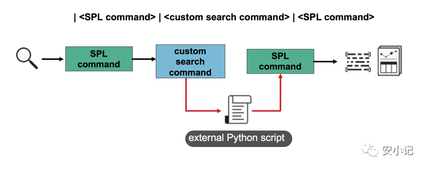
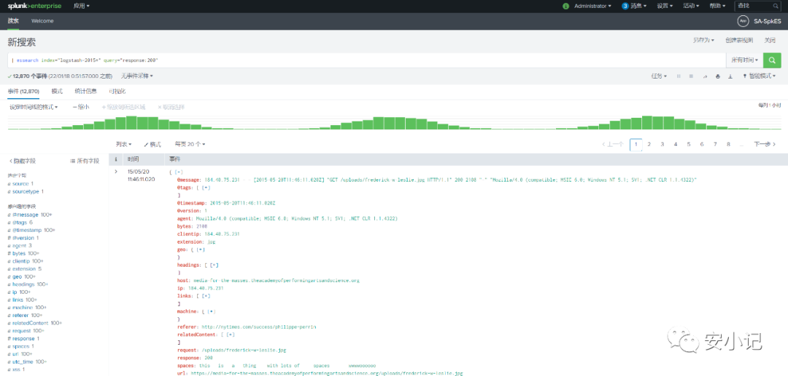
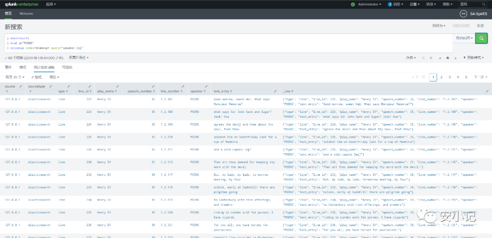
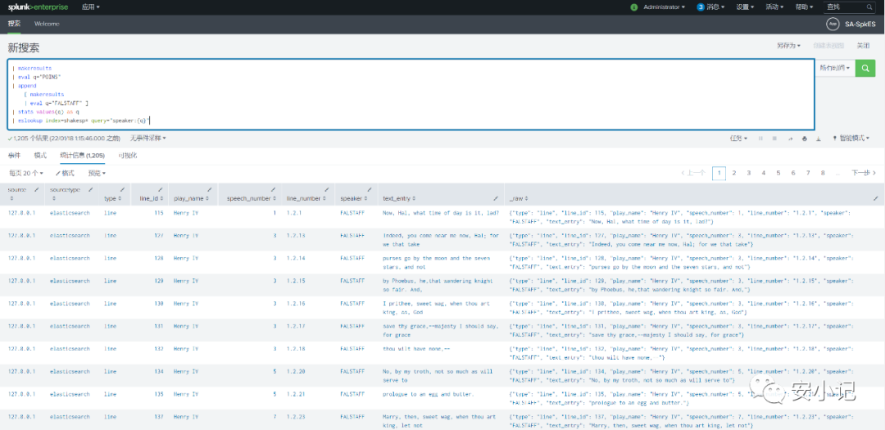

前言

Splunk和基于Elasticsearch的ELK技术栈都是日志分析领域两个使用频率较高的产品。Splunk作为一款昂贵的商业产品，其用户体验要优于Elasticsearch，用过的Splunk的人都会”真香“。

实际环境中，可能会存在以下几个问题：

1.  因Splunk订阅费昂贵，未必所有日志都往Splunk存，不能存的日志第一选择是存在Elasticsearch；


2.  如果已经存在Elasticsearch中的数据要在Splunk中检索，要么使用转发工具将日志迁移到Splunk，要么重新从数据源接一份数据到Splunk，这种做法成本相当费时费力；

3.  各种日志离散存储在不同Elasticsearch中，不同类型数据库很难快速关联查找；

其实基于Splunk开放的能力，是可以通过`自定义搜索命令`来打通各存储类型之间的链接。这点在Splunk官方文档中对`自定义搜索命令场景`描述中，就提到了”将非Splunk的外部数据导入到Splunk搜索通道中“的能力。

Splunk搜索命令是基于通道的，能够将Elasticsearch的数据嵌入到Splunk的搜索通道中，这样可以有两个好处：

1.  可以在Splunk直接对Elasticsearch检索，相当于在Splunk中构建一个Elasticsearch客户端。这里可能有人要问了，Kibana已经Elasticsearch客户端了，为什么还要多此一举使用Splunk来做统一检索呢？笔者觉得Splunk检索语法支持通道，检索语句可以更灵活，其使用场景更丰富。

2.  搜索通道中的数据是可以相互关联，做lookup操作的，意味着不同的日志之间可以互相富化，提高日志使用质量。

3.  通过自定义命令获取的数据是不会在Splunk中落地的，意味着不会占用Splunk的订阅License，相当于一定程度的“白嫖”。

总的来说，对于Splunk重度用户，可以将部分数据保留在Elasticsearch集群上，在不影响使用体验的前提下可以有效降低License费用；对于混用Splunk和Elasticsearch用户，可以将搜索体验统一化，提供更好的用户体验；对于想白嫖的用户，也完全可以申请一个开发者License（每天10G，免费），在数据不落地的场景下使用Splunk的功能。

### 自定义搜索命令

自定义搜索命令是用户定义的 Splunk 搜索处理语言 (SPL) 命令，可扩展 SPL 以满足特定需求。自定义命令底层是一个脚本，这个脚本可以使用不同编程语言实现，不过建议还是用python，Splunk原生的命令大部分都是使用python实现的。

自定义搜索命令是与`splunkd`进程中一同运行的外部执行脚本：

1.  Splunk解析 SPL 的每一行并确定搜索命令是否为自定义。自定义搜索命令由**commands.conf** 中的一个`stanza`指定。

2.  如果搜索命令是自定义的，Splunk会运行该命令的 Python 脚本。

3.  Splunk通过**STDIN**以块的形式通过Python脚本处理搜索结果，并通过**STDOUT**将它们输出。

4.  处理完 Python 脚本后，搜索结果重新进入主搜索管道。

下图说明了搜索结果如何退出并重新进入自定义搜索命令的搜索管道：



在整个自定义搜索命令过程中，**splunkd**和 Python 脚本通过一系列**getinfo**和**execute**命令交换元数据。

1.  **splunkd**发送**getinfo**命令以从 Python 脚本请求信息，包括命令类型和必填字段。

2.  **splunkd**为管道中的每个搜索结果块发送单独的**执行**命令。

3.  Python 脚本处理每个搜索结果块。

4.  Python 脚本将响应发送回**splunkd**。

在所有搜索结果通过 Python 脚本后，**splunkd**关闭**STDIN**管道以终止进程。

#### 自定搜索命令类型：

用户可以自定义以下搜索命令：

| 命令类型 | 描述 | 例子 |
| --- | --- | --- |
| 流命令 | 流命令逐一处理搜索结果，对搜索返回的每个事件应用一种转换。 | `eval`, `fields`, `makemv`, `rename`, `regex`, `replace`, `strcat`, `typer`, `where` |
| 转换命令 | 转换命令将搜索结果转换为数据表。这些命令将每个事件的指定单元格值“转换”为 Splunk 软件可用于统计目的的数值。 | `chart`, `timechart`, `stats`, `top`, `rare`, `addtotals` |
| 生成命令 | 生成命令从一个或多个索引获取信息而不执行任何转换。生成命令是事件生成或报告生成。这些命令不需要任何输入并且出现在前导管道之后的搜索开始处。 | `dbinspect`, `datamodel`, `inputcsv`, `metadata`, `pivot`, `search`, `tstats` |
| 数据集处理命令 | 数据集处理命令需要在命令可以运行之前就位整个数据集。这些命令不能转换，不能分发，不能流式传输，也不能编排。在特定情况下或使用特定参数时，其中一些命令适合其他类型。 | `sort`，`eventstats`以及一些模式`cluster`，`dedup`，`fillnull` |

#### 自定义命令使用场景

自定义搜索命令可以使用在绝大部分SPL使用场景中，最常见用例有：

-   新增Splunk 尚未提供数据处理方式处理数据。例如，如果希望GeoHex 格式来提高地理空间搜索查询的性能。可以创建自定义搜索命令以在索引时将 GeoHex 格式应用于事件。

-   将未被Splunk索引的外部数据导入到Splunk搜索管道。例如，如果希望从 Jira 部署中提取问题并在 Splunk中搜索这些问题，就创建调用 Jira 的 API 的自定义搜索命令，将这些问题作为事件导入Splunk中。

-   将搜索结果导出到外部系统。例如，如果想用Splunk中的搜索结果在 Jira 中创建ticket，可以创建一个调用 Jira 的 API 的自定义搜索命令，以从搜索中捕获事件并将它们保存为 Jira 的ticket。

### Elasticsearch接口

要在Splunk中直接搜索Elasticsearch，就是将Elasticsearch接口封装到Splunk的自定义命令中。对于Elasticsearch来说最简单的就是将`elasticsearch-py`封装到命令中。

`elasticsearch-py`提供Elasticsearch所有Api，考虑到开发难度和需求，可以直接使用`search`接口中的`query_string`方法，该方法作为搜索的入口。

使用`query_string`这个接口，主要是因为语法简单，可以实现大部分检索能力（可以看成是kibana上的KQL的简化版本），也就避免了输入冗长的json检索语句。

在Splunk搜索命令脚本中，将`query_string`的接口参数暴露给用户，这些参数会作为Splunk自定义搜索命令的输入参数，执行搜索命令的过程就是使用`elasticsearch-py`调用`string_query`的过程。这样做的好处是，在不增加开发量的基础上，可以保证Elasticsearch的原生的检索能力。

关于Elasticsearch`query_string`接口信息可以查看官方文档Query string query， `elasticsearch-py`使用可以查看这个官方文档Python Elasticsearch Client。

#### 接口配置

与使用Kibana类似，在第一次启动Kibana需要指定Elasticsearch节点信息，同理，如果要使用Splunk检索Elasticsearch也必须指定检索的集群；在Kibana启动后，还需要在页面中添加索引的Index。这些配置信息，是Splunk链接Elasticsearch的关键，需要在正式检索数据前预定义好。

#### 索引定义

Splunk自定义命令的逻辑实现是Python代码，在实际使用过程中，需要处理Index通配符的问题；还是拿Kibana作为参考，在Kibana检索时，是在选定的Index的通配符中检索的，在Splunk也必须实现这个基本功能才算完整。要实现通配符功能，首先明确Elasticsearch的索引Index的命名规范：

```
受文件系统的限制，仅可能为小写字母，不能下划线开头。同时需遵守下列规则：
    不能包括 , /, *, ?, ", <, >, |, 空格, 逗号, #
    7.0版本之前可以使用冒号:,但不建议使用并在7.0版本之后不再支持
    不能以这些字符 -, _, + 开头
    不能包括 . 或 …
    长度不能超过 255 个字符
```

通配符算法可以参考这位大佬的算法实现 Leetcode44. 通配符匹配 Python实现。

#### 时间区间

作为日志检索，时间是关键重要的元素，不管在Splunk还是在Kibana中，时间都是单独输入模块作为日志检索的时间区间。在接口设计中，需要将Splunk检索时间作为参数传入到Elasticsearch接口中，而Splunk中时间参数不是定义在命令中，需要通过Splunk检索任务上下文信息来获取时间信息。

### SA-SpkES

SA-SpkES是将Elasticsearch接口封装成Splunk自定义命令而开发的一个Splunk App，这个App中的内容就是自定义搜索命令，将Elasticsearch python客户端封装成Splunk可以直接使用的命令。

#### 配置定义

连接Elasticsearch需要指定参数，对于这些参数有两种解决方式：

1.  在自定义命令中每次都带着连接参数：这种方式灵活性强，但每次使用命令都必须添加一堆参数，使用起来臃肿；

2.  将参数存在在配置文件：这种方式牺牲了一定的灵活性，但使用起来更加轻便，整体感觉会更接近Kibana；考虑到体验性，SA-SpkES选择使用第二种方式。

配置大概是长这样的：

```
[client]                   # 必须有该stanza
keys = default             # 定义有哪些client可以使用，用于连接的Elasticsearch节点连接信息，使用英文逗号隔开;

[index]                    # 必须有该stanza
keys = bank, logstash-*    # 定义有哪些index可以使用，支持通配符*和?，使用英文逗号隔开;

[client_default]           # 定义具体的连接参数；下划线"_"后的名称必须是上面定义keys中的值;
hosts = 127.0.0.1:9200
http_auth = elastic,elastic # <账号,密码> 目前使用是默认的connection_class=Urllib3HttpConnection来连接Elaticsearch，此处定义的是urllib3.make_headers(basic_auth=http_auth)
scheme = http

[index_bank]               # 定义具体的index参数; 下划线"_"后的名称必须是上面定义keys中的值;
client = default           # 指定该Index对应的Elasticsearch节点，该节点信息在"[client_default]"中定义
timefield = @timestamp
timeformat = %Y-%m-%dT%H:%M:%S.%fZ
source = 127.0.0.1         # 显示在Splunk中的`source`的值，可自定义
sourcetype = elasticsearch # 显示在Splunk中的`sourcetype`的值，可自定义

[index_logstash-*]
client = default
timefield = @timestamp
timeformat = %Y-%m-%dT%H:%M:%S.%fZ
source = 127.0.0.1
sourcetype = elasticsearch

[index_shakesp*]         # 非时间类数据，可以不配置timefield和timeformat字段
client = default
source = 127.0.0.1
sourcetype = elasticsearch
```

配置文件会保存在`/SPLUNK_HOME/etc/apps/SA-SpkES/default/elasticsearch.conf`中，参考官方自定义命令的 logging.conf 配置方法而设计的Elsticsearch配置文件。`client`和`index`块中分别只有`keys`值，该值是下面`client_*`和`index_*`值，`keys`中定义的值会作为路径告诉自定义命令执行程序该去哪个`stanza`找到可用的信息。配置文件设计说明可参考官方的文档command.conf。如果能够理解`logging.conf`的配置说明，也就能命令这个配置文件含义了。

在SA-SpkES中，如果有时间字段要求，是需要指定`timefield`和`timeformat`的，否则时间字段会解析异常。

#### 代码设计

目录结构

```
SA-SpkES
├── README
│   └── logging.conf.spec
├── bin
│   ├── __pycache__
│   ├── default.py
│   ├── escommand.py
│   ├── eslookup.py
│   ├── essearch.py
│   └── packages
├── default
│   ├── app.conf
│   ├── commands.conf
│   ├── elasticsearch.conf
│   ├── logging.conf
│   ├── searchbnf.conf
│   └── transforms.conf
├── lib
│   ├── __init__.py
│   ├── __pycache__
│   ├── client.py
│   ├── elasticsearch
│   ├── elasticsearch-py-7.6.0
│   ├── elasticsearch-py-7.6.0.tar.gz
│   ├── elasticsearch_dsl
│   └── splunklib
├── lookups
└── metadata
    └── default.meta
```

关键的几个文件有：

**./bin/escommand.py**：封装了主要Elasticsearch的接口，接口使用Elasticsearch提供的`help.scan`方法来获取数据，该文件未直接提供Splunk的命令；

**./bin/essearch.py**：封装了`essearch`命令，是一个`GeneratingCommand`类命令；

**./bin/eslookup.py**：封装了`eslookup`命令，是一个`StreamingCommand`类命令；

**./default/elasticsearch.conf**: 定义了elasticsearch连接和要检索Index的参数；

#### 命令使用

SA-SpkES核心有两个命令：

-   essearch

-   eslookup

这两个命令使用在不同场景中。

**essearch**

`essearch`是直接检索Elasticsearch用的，可以简单理解就是`Elasticsearch在Splunk实现的检索客户端`，这个命令必须放在检索语句最前面，是用于`产生数据`的；执行该命令后，从Elasticsearch检索到的数据就会进入到Splunk工作流中。例如，在Splunk直接检索Elasticsearch，SPL可以使用自定义命令`essearch`这样写:

```
| essearch index="logstash-2015*" query=*
```

`index` 和`query`分别对应着Elasticsearch中的Index和`query_string`的检索语句。



**eslookup**

`eslookup`是用于检索语句中存在上下文关联的检索，例如这样的SPL语句：

```
| makeresults
| eval q="POINS"
| eslookup index=shakesp* query="speaker:{q}"
```

`eslookup`是自定义命令，这个SPL语句中除最后一行外，其余前面几行可以看成是`eslookup`的上文信息。例如该实例中，`q`这个字段的值是前一个搜素语句的结果，该结果可以作为`eslookup`这个命令`query`参数的补充，填充到Elasticsearch`query_string`的检索语句中。



也可以是填充多个值，例如如下这样的SPL:

```
| makeresults
| eval q="POINS"
| append
    [ makeresults
    | eval q="FALSTAFF" ]
| stats values(q) as q
| eslookup index=shakesp* query="speaker:{q}"
```



#### 优化空间

目前SA-SpkES还算是一个demo版本，对Elasticsearch调用方式仍不太优雅，在使用`help.scan`这个接口的命令在Splunk界面有少许不太流畅，后期可以尝试使用其他拉取数据方式，毕竟Elasticsearch提供了很丰富的数据获取接口。另外，Elasticsearch配置信息不优雅，没有前端界面修改Elasticsearch配置信息，对新手使用不太友好。

还是就是，当前App使用的Elasticsearch版本是7.6.0，还没有适配其他版本。

### 小结

使用自定义命令，封装Elasticsearch接口，将Splunk作为一个Elasticsearch客户端使用，可以极大扩展了Splunk使用范围。基于自定义命令调查第三方接口查询方式的数据是不会落在Splunk上的，意味着所有存储在Elasticsearch上的数据是不会占用Splunk License下，可以充分使用Splunk优秀的检索能力。

本文中只是将Elasticsearch封装成Splunk命令，同理，其他任意Api或者client类的第三方组件都可以被封装成命令，有利整合组织内容数据，降低Splunk使用成本，无疑对于Splunk在组织内大规模使用具有重要意义。

文中提到的SA-SpkES已发布到Github，感兴趣的小伙伴可以点击"查看原文"直达。

### 后语

这边文章前前后后写了快2个月，一是近一个月来工作上事情特别多，基本不可能准点下班；二是家里的事也多，能够安安静静做点东西的时间不多；三是强迫症犯，总想把事情做的特别完美，但事情却总很难以完美。直至今日看着SA-SpkES这个App，我依然觉得是个半成品。我始终认为，“知道”和“做到”之间有巨大的鸿沟，SA-SpkES实现原理很简单，但要做出一个能够在生产环境适用很难，再加上我的强迫症，才导致这篇文章磨磨唧唧了那么久。甚至还会有点担心最后会不会因为坚持不下去然后这篇文章就烂尾了。

嗯，总算完成了。算是对自己2021年的一个工作成果吧。

---

*本文首发于微信公众号「安小记」，[原文链接](https://mp.weixin.qq.com/s/WisRKnT_9avg75t6tRwaiQ)。*
