**备注：**

本文是使用VelociraptorGUI页面进行事件调查的快速指南，更详细内容请查看官方文档。

**1\. 概述-Overview**

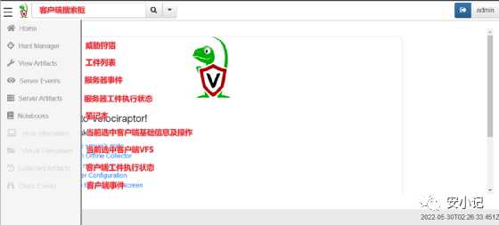

各功能区说明:

•Hunt Manager: 执行威胁狩猎页面，可以对批量主机执行工件；

•View Artifacts：工件列表，可以查看所有可用工件，含系统内置以及第三方导入的工件；


•Server Events：Server事件查看页面；（事件是指当时正在发生的事件；)

•Server Artifacts：Server类工件执行状态查看页面；

•Notebooks：创建并执行notebook页面;

•Host Information：当前选中的客户端主机基础信息及状态

•Virtual Filesystem：VFS文件查看；

•Collected Artifacts：Client类工件执行状态查看页面；

•Client Events：Client类事件查看页面;

**2\. 基本概念**

**2.1 VQL-Velociraptor Query Language**

VQL是Velociraptor设计和功能核心。VQL类似与SQL语句，通过VQL在Velociraptor完成事件调查取证响应(DFIR)全部事情；

VQL基本语法如下图:

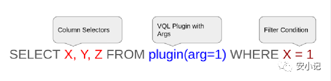

查询以 SELECT 关键字开始，Column Selectors然后是FROM关键字列表和VQL Plugin可能采用的参数。最后，我们有一个WHERE关键字，后跟一个过滤器表达式。

**2.2 客户端-Client**

在搜索框中搜索主机名或在搜索框右边下拉框中选择Show All，可以找到历史连接的客户端主机。(更复杂的搜索需要完整的 VQL 语法在notebook中完成。)

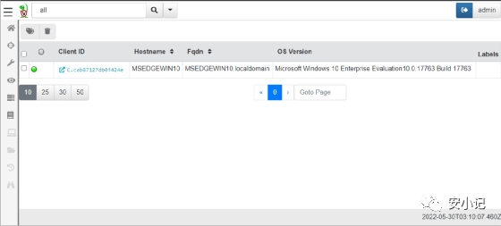

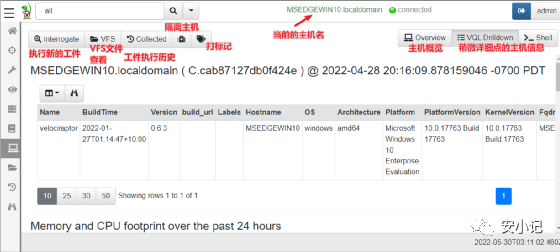

**2.3 工件-Artifact**

工件是VQL语句的进一步封装，一个工件可以实现一个或多个功能。在工件列表可以查看所有工件。

工件格式是YAML格式，例如一个查询进程树的工件Generic.System.Pstree是这样的:

```ini
name: Custom.Artifact.Name
description: |
   This is the human readable description of the artifact.
type: CLIENT
parameters:
   - name: FirstParameter
     default: Default Value of first parameter
sources:
  - name: MySource
    precondition:
      SELECT OS From info() where OS = 'windows' OR OS = 'linux' OR OS = 'darwin'
    query: |
      SELECT * FROM info()
      LIMIT 10
```

工件包含以下参数：

•Name：工件包含一个名称。按照惯例，名称由层次结构中的点分割。名称出现在 GUI 中并且可以在上面进行搜索。

•描述：工件包含人类可读的描述。描述字段也可在 GUI 中搜索，因此应包含相关关键字，使工件更容易被发现。

•类型：工件的类型。由于 Velociraptor 在许多不同的上下文中使用 VQL，工件的类型暗示了工件要运行的 GUI。例如，一个 CLIENT 工件是要在端点上运行的，而一个 SERVER 工件是要在服务器上运行的。工件类型仅与 GUI 相关。

•参数：工件可以声明参数，在这种情况下，它们可以由 GUI 用户设置以自定义工件集合。
来源：工件可以定义许多 VQL 来源来生成结果表。每个源生成一个表。如果提供了多个来源，则它们都必须具有唯一的名称。

•前提条件：源可以定义前提条件查询。此查询将在收集源之前运行。如果它不返回任何行，则将跳过该集合。先决条件使得从所有主机收集工件（例如在搜寻中）是安全的，并确保只有对收集有意义的工件才能真正运行。

•查询：将用于收集该源的查询。请注意，由于每个源都必须生成一个表，因此查询应该只有一个SELECT子句，并且它必须位于查询的末尾，可能跟在任何LET查询之后。

**2.4 笔记本-Notebook**

Notebooks 是交互式协作文档，可以将markdown和VQL查询交错插入以创建交互式报告。笔记本通常用于跟踪处理一个或多个事件协同的调查。

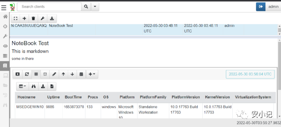

另外，在每个工件执行页面都有Notebook界面，可以对工件结果进行处理。

**2.5 事件-Events**

在Velociraptor中，VQL是某一次具体执行或操作，每执行一次VQL可获取一个表格数据。而事件Events是VQL的持续运行，可以通过VQL查看正在发生的事情或做出动作；Events根据执行VQL位置不同分为Server和Client，分别对应着Server Events和Client Events。

在工件中type值为server\_event是Server Events工件，client\_event是Client Events。

事件Events可以对正在发生的事件进行动态响应，例如Client Events可以持续收集客户端主机的的DNS请求记录，Server Events可以持续监控客户端主机上传的DNS记录，自动执行DNS域名检测；

**2.6 VFS-Virtual Filesystem**

VFS是Velociraptor构建用于查看客户端主机文件系统的，VFS查看的是本地文件的缓存。

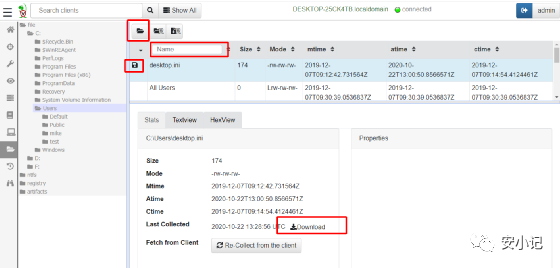

**2.6.1 Accessor**

accessor访问器是指Velociraptor获取文件系统的方式，有以下几种:

•file: 使用系统API列出文件或目录

•ntfs: 使用Velociraptor内置的NTFS解析器来访问隐藏的NTFS文件和备用数据流(ADS)

•registry：注册表访问

**3\. 工件执行**

1.进入目标客户端主机页面

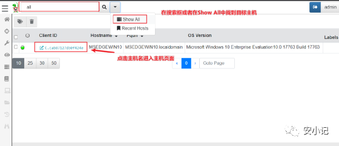

**1.进入客户端工件列表**

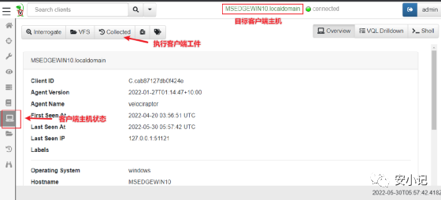

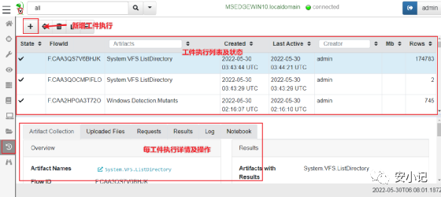

**2.选择要执行工件**

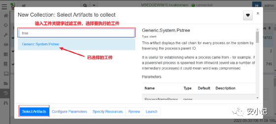

**3.输出工件执行参数**

 点击工件名称左边的🔧图标可配置工件参数

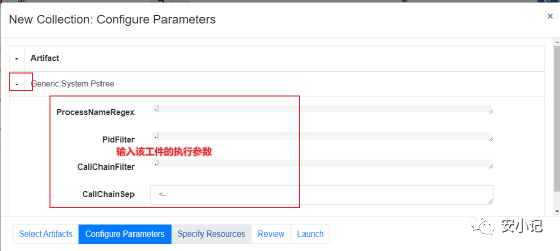

**4.指定工件执行资源**

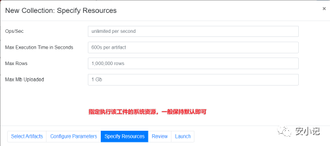

**5.查看工件任务**

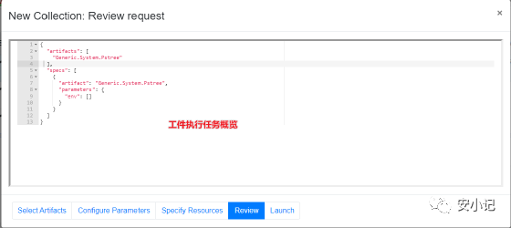

**6.在点击Launch后工件开始执行；**

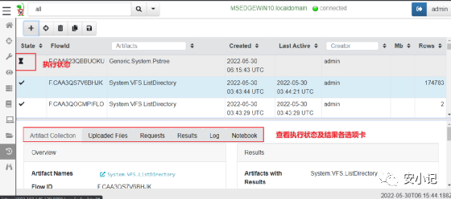

**7.查看执行结果**

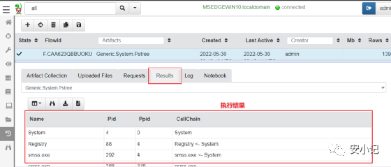

**4\. 二次检索**

在执行完工件后，可以Results选项卡查看结果，但实际情况下往往对结果做二次检索过滤，可以切换到Notebook选项卡下对结果过滤；

**1.进入工件的Notebook页面**

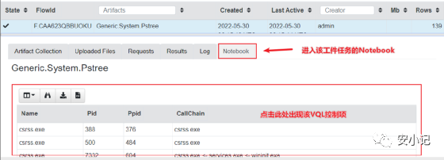

**2.点击VQL卡片，进入编辑状态**              点击VQL结果的空白处，弹出控制项，点击✏按钮进入VQL编辑状态

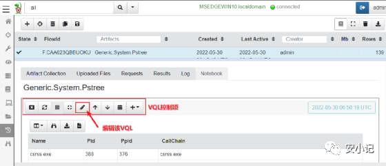

**3.根据需要修改VQL**

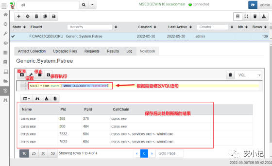

工件下Notebook的VQL都必须基于该工件的执行结果，因此VQL都必须基于SELECT \* FROM source()该基础语句做过滤或字段选择，其他语句不能生效。

**小结：**

本文简单介绍Velociraptor基本的图形化使用，可以满足基本的使用需要；因篇幅原因，VQL语句还有很多高阶的特性得及讲，往后有机会再逐步介绍吧~

---

*本文首发于微信公众号「安小记」，[原文链接](https://mp.weixin.qq.com/s/pAXxsjt6-4TQmqdW0oNzVg)。*
