转载备注：转载归档文章；感谢公司SRC小姐姐帮我文章美化那么多，赞赞赞~~~

**写在最前面：**

相信有认真关注我们公众号的小伙伴都看出来了，这是一系列介绍**顺丰网络安全DFIR（数字调查与事件响应）平台**从0到1实践之路的连载文章。如果你还没看过前面文章，为了可以更快速吸收本篇文章的精髓部分，笔者建议先从第一篇开始往后追。


-   第一篇：[《浅谈网络安全事件调查那些事》](http://mp.weixin.qq.com/s?__biz=MzU3OTAyODk4MQ==&mid=2247484596&idx=1&sn=fb0fba8d31fe37638766658f873a25bf&chksm=fd6d162eca1a9f38fffba108b1dc1fe348360c99381f863f7dff1cbeb5691617b4f3223b1754&scene=21#wechat_redirect)

-   第二篇：[《顺丰网络安全DFIR平台实践之路》](http://mp.weixin.qq.com/s?__biz=MzU3OTAyODk4MQ==&mid=2247484904&idx=1&sn=7541fe00eda91ed8d58d43d77638f4d1&chksm=fd6d1772ca1a9e64f071e1e03f5cd0b80634fb2f740d2923eac09ac44c1c680dce8cc5547123&scene=21#wechat_redirect)

-   第三篇：[《Velociraptor实践-GUI基础操作》](http://mp.weixin.qq.com/s?__biz=MzU3OTAyODk4MQ==&mid=2247485401&idx=1&sn=d7e92309ef6d82ba3b1b3fc594a9e23f&chksm=fd6d1543ca1a9c55210d5b7d1cd8aafb2df01630cf825ae3437a9ed013c688cbba86d7f21fb8&scene=21#wechat_redirect)

-   本篇：《Velociraptor实践-KoiMiner排查》

前面几篇介绍了事件调查响应的生命周期和方式，Velociraptor是什么（一款网络安全事件调查平台），顺丰网络安全选择使用Velociraptor来实现事件调查响应工程化的原因，以及Velociraptor的部署和基础操作。


**说明：**

• 本文仅简单演示排查KoiMiner木马过程，未分析病毒文件、未溯源；关于该木马更详细情况请参考文章: 《KoiMiner挖矿木马变种入侵，超5000台SQL Server服务器被控制》；

• 本文主要演示Velociraptor在实际调查过程中可以用到的思路和方法，思路方法并不唯一，可以根据需要灵活调整；

• 默认认为阅读该文档读者已具备初步使用Velociraptor能力。

## 一、背景
“嘀嘀嘀，嘀嘀嘀”，安全响应平台的一条告警通知响起，显示某终端出现了异常活动，我立刻打开安全监控平台，查看了相关告警详细信息。


```ini
A new process has been created.

Creator Subject:
Security ID: SYSTEM
Account Name: MSEDGEWIN10$
Account Domain: WORKGROUP
Logon ID: 0x3E7

Target Subject:
Security ID: NULL SID
Account Name: -
Account Domain: -
Logon ID: 0x0

Process Information:
New Process ID: 0x179c
New Process Name: C:\Windows\System32\attrib.exe
Token Elevation Type: %%1936
Mandatory Label: Mandatory Label\System Mandatory Level
Creator Process ID: 0x2270
Creator Process Name: C:\Windows\Help\csrss.exe
Process Command Line: "C:\Windows\System32\attrib.exe" C:\Windows\Help\lsass.exe -s -r -a -h
```

相信大家也注意到了，该告警中出现了lsass.exe执行命令的特征，是可疑告警；因未确认该告警真实性以及具体告警原因，本次调查按照通用事件调查方式方法展开。

## 二、排查
告警中出现进程信息，优先从进程信息入手：

**1\. 查找进程信息，确认进程是否存在风险；**

1.1 从告警记录中的Creator Process ID字段可得知Pid是8816(0x2270)；使用Windows.System.Pslist工件获取进程列表信息:

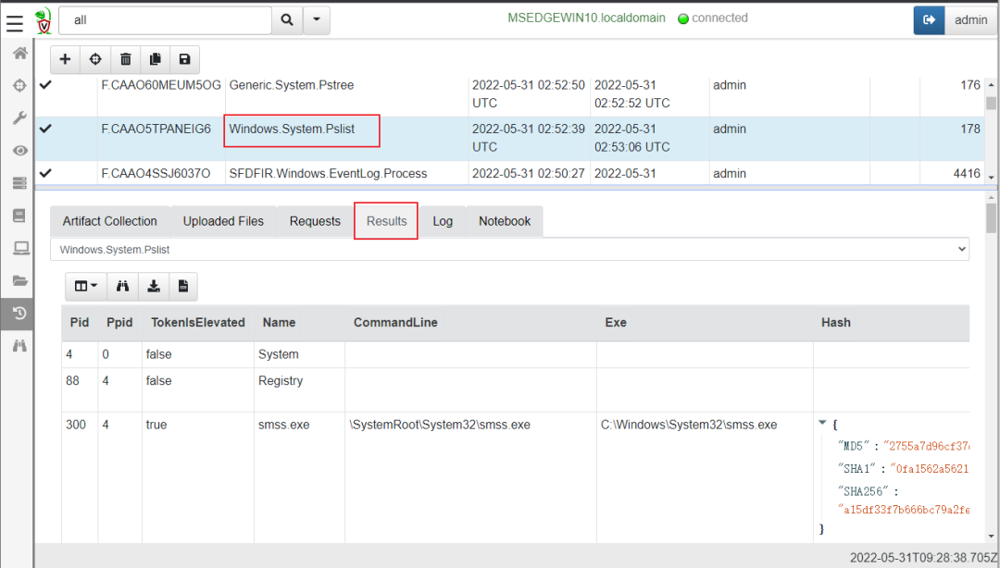

1.2 为了快速定位到目标进程，切换到Notebook标签页，修改原始VQL语句，筛选出目标进程信息；其中过滤条件是PID=8816

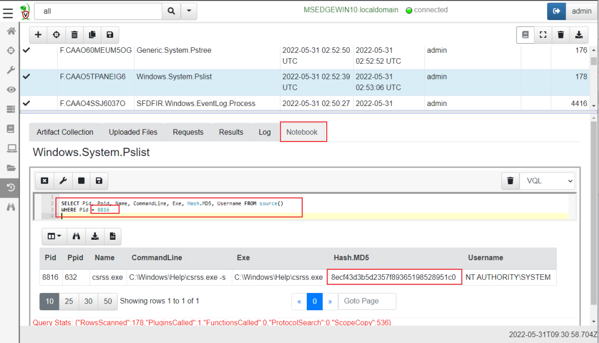

将该MD5值(8ecf43d3b5d2357f89365198528951c0)丢到微步进行情报数据关联：

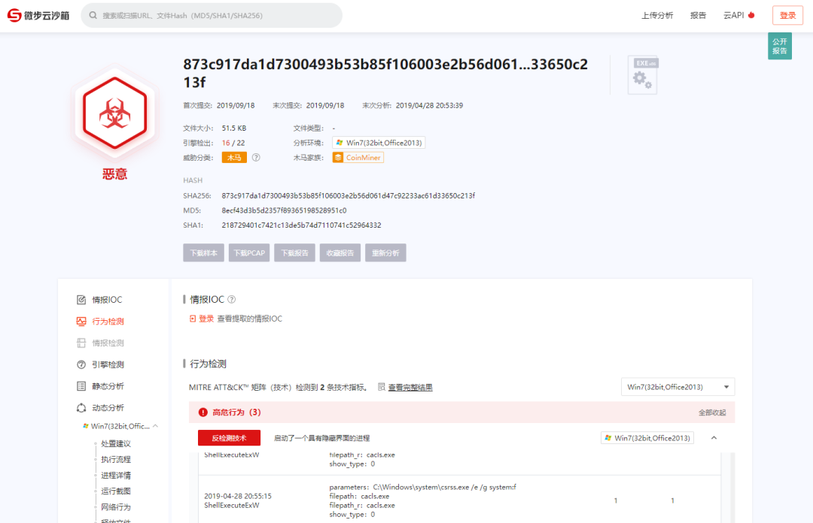

根据情报信息可以确认该进程是恶意进程，需要进一步确认排查。

1.3此时找到父进程PID=632，添加VQL的Pid为632的条件，进一步确认父进程详情:

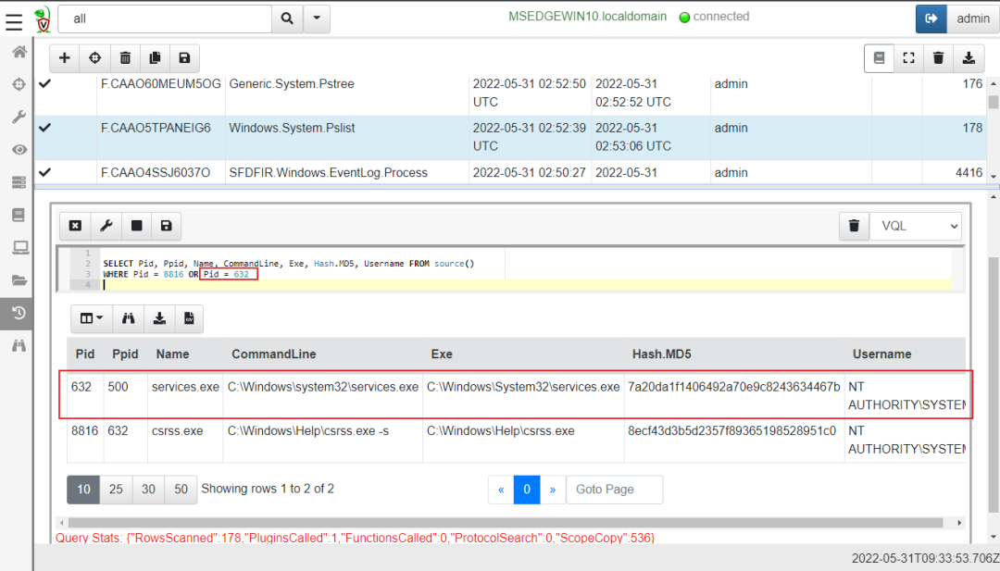

可以看到父进程是系统服务进程，同样查看下父进程的MD5(7a20da1f1406492a70e9c8243634467b):

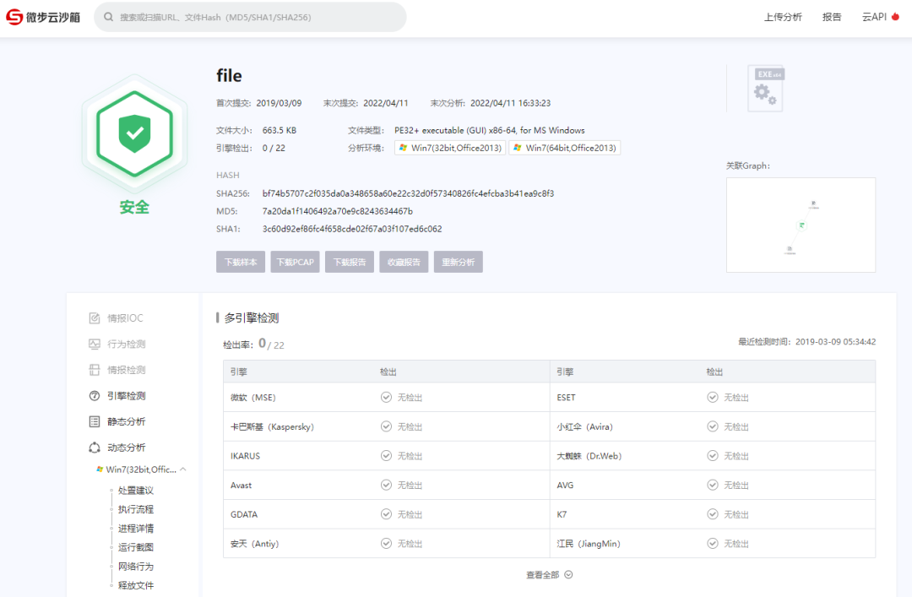

此时可以确认父进程是一个正常的进程。

**2\. 查找服务信息**

为了进一步确认csrss.exe是由哪个服务执行的，需要另外执行工件从注册表中获取service详情.

2.1. 使用SFDFIR.Windows.System.Services查找进程所对应的服务:

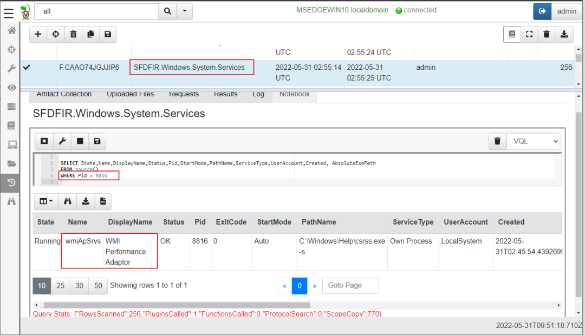

此时找到名为wmiApSrvs的服务，该服务与情报中的信息相符，可以确认该恶意文件为KoiMiner木马病毒。同时也确认服务创建时间是2022-05-31T02:45:54.4392699。

2.2 调查wmiApSrvs服务创建信息

路线1- SC方式创建service服务。

执行SFDFIR.Windows.EventLog.Process工件，获取进程启动历史记录，从历史记录中查找SC命令进程调用：

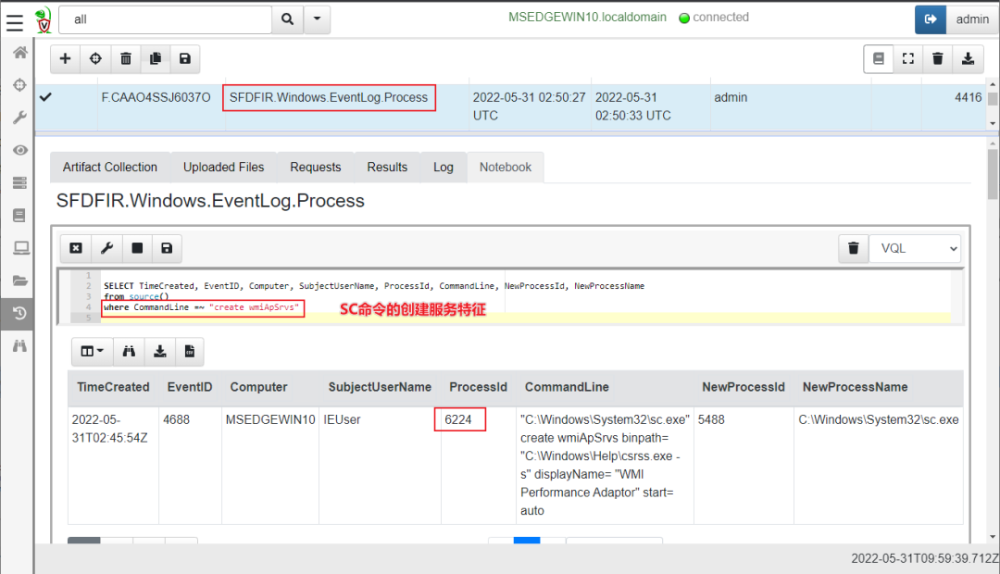

找到创建服务的进程是6224.

继续在SFDFIR.Windows.EventLog.Process查找6224进程信息：


继续在SFDFIR.Windows.EventLog.Process查找4776进程信息：

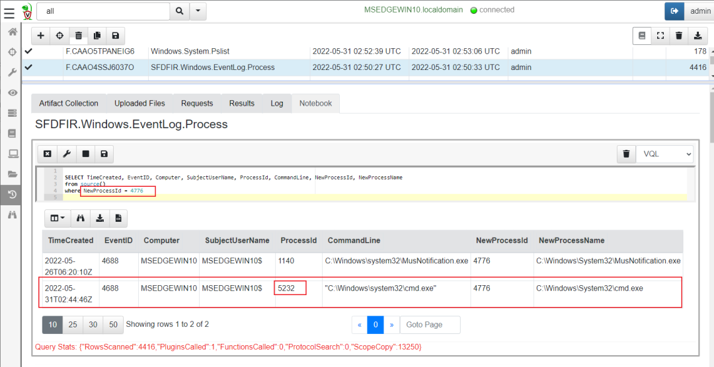

继续在SFDFIR.Windows.EventLog.Process查找5232进程信息：

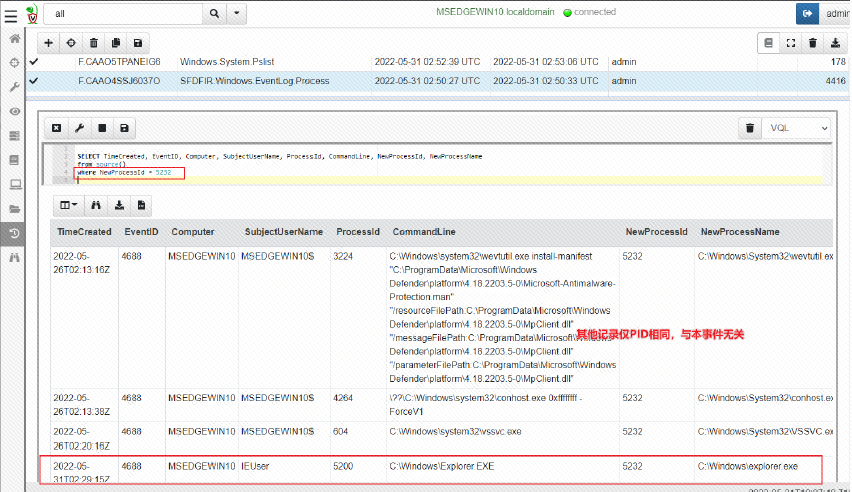

除红色框线内的，其他记录发现仅PID相同，与本事件无关。

2.3 返回到前面排查到的进程6224。

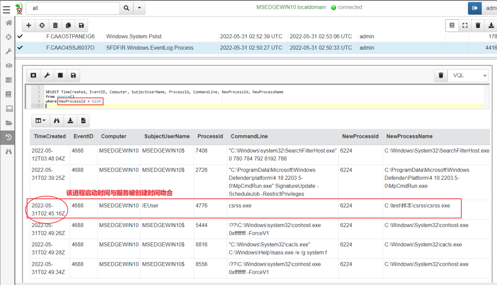

进一步排查恶意进程6224的动作，此时依然基于SFDFIR.Windows.EventLog.Process统计该进程执行的动作:

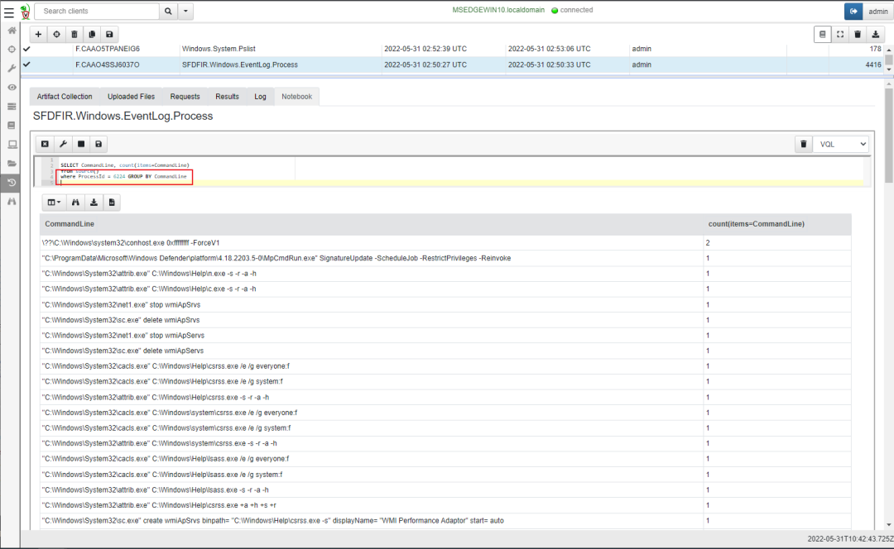

**三、结论**

**执行过程**

1\. 用户IEUser通过资源管理器打开CMD，并执行了恶意程序csrss.exe；

2\. 恶意程序csrss.exe创建了两个服务：

```sql
"C:\Windows\System32\sc.exe" create wmiApServs binpath= "C:\Windows\system\csrss.exe -p" displayName= "WMI Performance Adaptnr" start= auto
"C:\Windows\System32\sc.exe" create wmiApSrvs binpath= "C:\Windows\Help\csrss.exe -s" displayName= "WMI Performance Adaptor" start= auto
```

3\. 恶意程序csrss.exe执行了以下命令：

```sql
\??\C:\Windows\system32\conhost.exe 0xffffffff -ForceV1 2
"C:\ProgramData\Microsoft\Windows Defender\platform\4.18.2203.5-0\MpCmdRun.exe" SignatureUpdate -ScheduleJob -RestrictPrivileges -Reinvoke 1
"C:\Windows\System32\attrib.exe" C:\Windows\Help\n.exe -s -r -a -h 1
"C:\Windows\System32\attrib.exe" C:\Windows\Help\c.exe -s -r -a -h 1
"C:\Windows\System32\net1.exe" stop wmiApSrvs 1
"C:\Windows\System32\sc.exe" delete wmiApSrvs 1
"C:\Windows\System32\net1.exe" stop wmiApServs 1
"C:\Windows\System32\sc.exe" delete wmiApServs 1
"C:\Windows\System32\cacls.exe" C:\Windows\Help\csrss.exe /e /g everyone:f 1
"C:\Windows\System32\cacls.exe" C:\Windows\Help\csrss.exe /e /g system:f 1
"C:\Windows\System32\attrib.exe" C:\Windows\Help\csrss.exe -s -r -a -h 1
"C:\Windows\System32\cacls.exe" C:\Windows\system\csrss.exe /e /g everyone:f 1
"C:\Windows\System32\cacls.exe" C:\Windows\system\csrss.exe /e /g system:f 1
"C:\Windows\System32\attrib.exe" C:\Windows\system\csrss.exe -s -r -a -h 1
"C:\Windows\System32\cacls.exe" C:\Windows\Help\lsass.exe /e /g everyone:f 1
"C:\Windows\System32\cacls.exe" C:\Windows\Help\lsass.exe /e /g system:f 1
"C:\Windows\System32\attrib.exe" C:\Windows\Help\lsass.exe -s -r -a -h 1
"C:\Windows\System32\attrib.exe" C:\Windows\Help\csrss.exe +a +h +s +r 1
"C:\Windows\System32\sc.exe" create wmiApSrvs binpath= "C:\Windows\Help\csrss.exe -s" displayName= "WMI Performance Adaptor" start= auto 1
"C:\Windows\System32\sc.exe" description wmiApSrvs "Provides performance library information from Windows Management Instromentation" 1
"C:\Windows\System32\attrib.exe" C:\Windows\system\csrss.exe +a +h +s +r 1
"C:\Windows\System32\net1.exe" start wmiApSrvs 1
"C:\Windows\System32\sc.exe" create wmiApServs binpath= "C:\Windows\system\csrss.exe -p" displayName= "WMI Performance Adaptnr" start= auto 1
"C:\Windows\System32\sc.exe" description wmiApServs "Provides performance library information from Windows Management Instromentations" 1
"C:\Windows\System32\net1.exe" start wmiApServs 1
```

**时间轴**

-   2022-05-31T02:29:15Z     IEUser打开资源管理器

-   2022-05-31T02:44:46Z     启动cmd

-   2022-05-31T02:45:16Z     执行恶意程序"c:\\test\\样本\\csrss.exe"

-   2022-05-31T02:45:54Z     创建wmiApSrvs服务

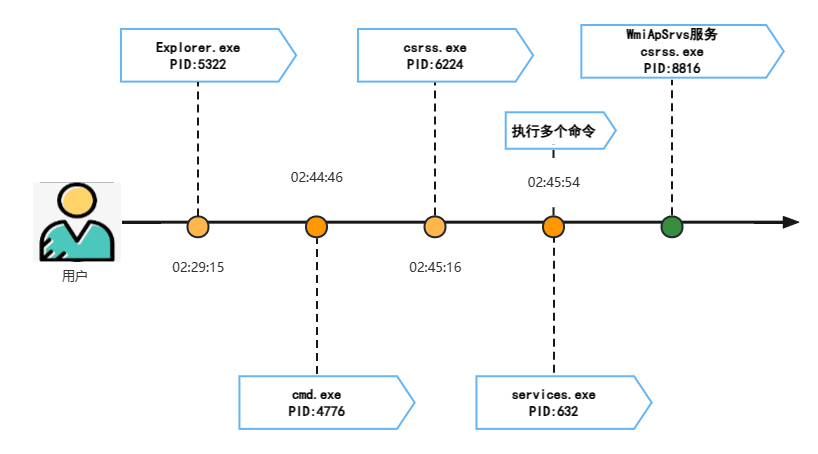

注：本篇报告为实验环境中搭建的失陷主机中挖矿病毒的演示场景，仅供内部响应人员DFIR的分享培训使用，非攻击事件。

---

*本文首发于微信公众号「安小记」，[原文链接](https://mp.weixin.qq.com/s/8Fd5F9z3sjXRajk-9bCx6Q)。*
