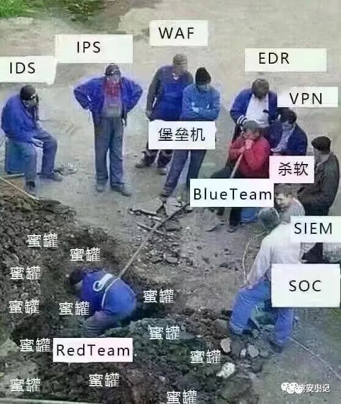
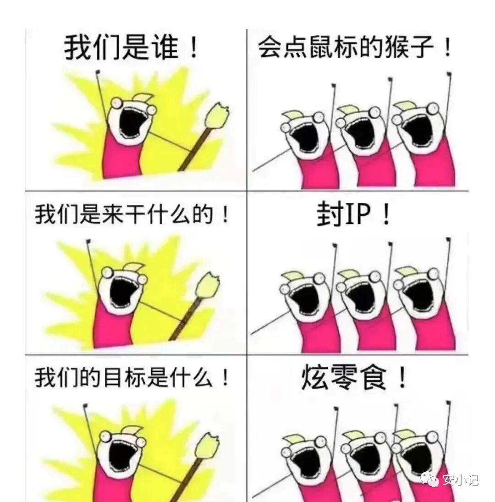

【题图：HW趣事】(来源网络，侵删)

\----------------分割线------------------

转眼参加HW已经第三年了，每年HW已然成为安全圈子热闹的盛会，仪式感满满像是过年一样。WB社区也成为HW期间重要信息交流地，在那里能感受到浓浓的“过节”气氛…

（所以，从WB那里盗了几张图，不过分吧 哈哈哈… ）

其实HW也已经打了那么多年，每年的对抗套路都差不多，差不了多少。但明显感觉到随着安全能力水平的不断提升，提前准备的策略越来越多，作为一线应急反入侵的菜鸡的我，应对起这种级别的对抗，也越来越顺手了，不再会像之前那样手忙脚乱。我觉得这些改变，并不是只有我变强了，而是整体防御水平提升了，然后我蹭了波团队成长的福利。

感谢团队的成就，才容我有喘息的机会。

在今天普天同庆的日子里，趁HW刚刚结束，还热乎劲，写写今年的一些感受吧。没啥干货，就说说HW期间一些感受，以及这一年在做的事情。

\----------------分割线------------------

对抗本质还是人与人对抗

不管是防宁的蓝队还是进攻方的红队，对抗的本盾还是人与人的对抗。

这是从攻防对抗视角来看，攻防对抗是当然是双方技术的较量，在对抗过程中，就看谁对技术造诣更深，能力强者，自然更容易拿到人头上分。

但其实，参与攻防对抗中的人不仅仅是蓝队和红队。比如，蓝队防守中的用户群众，就是以被动形式参与到对抗中的。如我之前说的所有那样，人是ISO模型中的第八层， 社工之类攻击是ISO中第八层攻击。

普通用户和组织内资产是信息网络安全最关键保护对象，但偏偏信息网络安全治理却又是一个“反人类”的过程，种种安全措施是反人类习惯的约束，如果安全措施得不到所保护用户群众理解和支持，那么这些用户反而会成为防守方另外一个“强大的对手”。

比如，在这次对抗过程中，就看到有用户在脉脉上吐槽“安全攻防演练太假”。用户之所以有这样认识，是因为HW开始前几周已经在公司内大规模宣导安全意识，避免中钓鱼攻击。

用户表面是吐嘈HW间期更严苛的监管给他们带来很多工作上的不便，其实是他们无法理解和接受这些应该坚守安全的规范。作为普通用户，他们只知道平常能做的事情他们现在不能做了，却无法认识一次不小心的点击、不小心打开一个文件就有可能失去对自己电脑控制权的这种“显而易见”的行为风险是有多高。隔行如隔山，我理解他们的感受，但也正是这样才更能领会安全责任的任重而道远。

对于钓鱼攻击各种社工套路年年有，年年有人中招，今年不少，明年也不会少。谁都不会承认自己就是那条会被钓的鱼，谁都认为自己不会上当受骗。而往往被钓的就是那些不以为然的用户。

（关于钓鱼的骚操作，之前的“碎碎念”已经写过了，这次就不重复了，有兴趣的同学可以翻翻之前的文章）

所以，人性，才是对抗中最大的弱点。

\----------------分割线------------------

安全情报

安全情报的价值在这几年的HW中越来越得到体现，现在常见的情报主要有这几种：

-   0day情报

-   IOC情报

-   TTP情报

但用的最多的还是IOC情报，而在实际安全运营中，内部很多安全威胁确实都是依靠实时动态更新的情报来发现的。尤其是在HW中，这种情报带来的优势会更加明显。

在对抗中，打的就是一个信息差，谁掌握更多信息(情报)，在对抗中就掌握更多主动权。比如，防守方对组织内部资产状态了解更透彻、漏洞更少、风险面更小，就掌握资产这个信息面主动权，可以有效收敛风险面，提前做好准备、预警，从而获取防守的主动权，这就是防守方内部的“情报”；如果是攻击队比防守队找到更多资产信息，意味着可以攻击的面更广，可以攻击的机会更多，攻击的成功率就更高。再比如，防守掌握0day情报更多、更准确，就能够更及时实施升级、关停、补丁等一系列缓解措施，将0day影响面降到最低；如果是攻击队掌握更多的0day，那可选择的攻击面就更广，更容易打进内部。

IOC情报最简单粗暴，防守方及时封禁、拦截、监控这些IOC，就可以快速跟踪、遏制攻击路径。

因此，封IP这个简单粗暴的动作是每个防守队的必备操作，以至于今年都出现了“猴子点鼠标”的梗了。

当然，IOC作为“痛苦金字塔”最底层的检测点，变化莫测，个人觉得这也是目前IOC这类指标最头疼的问题。不管这样，通过监控遏制情报中的IOC也是目前比较有效增加攻击队攻击成本、延缓攻击速度的方式方法之一了。

个人觉得，随着情报技术不断提升，安全情报数据也会像“个人数据”被认为是新时代“黄金”那样，安全情报也是安全领域的“黄金”，对这座“金矿”现阶段还是只开发了一点点的。

所以，安全情报应该会在未来对抗中发挥更大的作用，而最近两年的“情报作战”各种概念的蓬勃发展，也确实印证了这个潮流。

随着各组织防守安全能力增强，除了依赖情报厂商提供情报以外，我倒是觉得各防守方可以建立常态化的情报分享机制，从技术层面构建情报分享平台，互通有无。开源的技术平台都有了，就看有没有圈内大佬牵个头搞起来。哈哈哈，一个小念想，不知是否有可能参与建设。

\----------------分割线------------------

在做的事情

关注我这个号的朋友应该都知道，最近1年多都发的都是与Velociraptor迅猛龙这个工具相关的文章，这也是我最近1年多来主要工作。随着不断迭代优化，现在整个平台也算慢慢进入正轨，开始发挥一些有价值的作用，这是我甚感欣慰的。

这个迭代的过程，也算是一个历练的过程，要自己给自己提需求、自己设计业务逻辑、自己码代码、自己调试bug、自己部署服务。差不多变成半个码农，哦， 不对，码农只要写代码就行了，我是只要关于迅猛龙的东西都要干，比码农还不如…

作为一个从事安全的运营人员，其实设计产品、码代码这些事情应该算是“不务正业”了，但是看着自己一手做的东西能够在实际环境中落地，是一件蛮有成就感的事情；对于我来说，这个过程就像是拼乐高的过程，手里拿着积木，按照既定设想、拼接然后逐渐造型；玩乐高的人，其实不仅欣赏着最后的完美造型，更是感受着拼搭的过程；而我在负责迅猛龙的过程，也有点这种倾向吧。

当然，我这半吊子的开发，做出来的东西也只能小团队使用，真要正儿八经做个2C或者2B的产品，我还是掂量掂量。自己几斤几两还是知道的。

不过，对于小团队的工具开发，也可以给我足够的宽容度去尝试不同的技术，也就是说我只要去实现安全的业务目标就行，而不需去考虑其他非业务场景因素。

有时候就也觉得自己是团队中那种辅助奶妈的角色，就像王者荣耀中的蔡文姬那样强力补血使劲奶的那种，我现在做的事情就是给团队提供一款好的工具产品，能够提高安全事件中的调查效率和质量，实现“团队增益，持续续航”目标，就跟王者团战中使劲奶队友直至把对方血量耗完那样。

站开发角度看，我与其他后端、前端产品开发者不同的是， 专职开发岗位以开发技能为导向，只对业务功能其中一小模块负责，例如后端开发的同学可以不懂安全，但凭借产品经理对安全产品理解和输出，后端开发同学可以有很好完成安全产品后端功能开发，但让后端开发同学去开发前端页面，他们肯定是不干的，因为后端开发技术就只能做后端开发，他不会愿意也不太能随意切换自己技能方向（全线开发大佬请忽略…）。

而我更像是以安全能力为导向，更贴近实际场景。不管前端后端，Python、Golang、.net还是javascirpt，哪里有坑就填补哪里。对我来说，不管是啥开发，在我这里都是“面向Google开发”，主打的就是一个“奶”，全力辅助…  (不过，以后可能要学会“面向ChatGPT开发”了..)

总的来说，这一年来，做的事情很“杂”，也很“专”，偶尔会爬坑爬出的小情绪，也时常有“登顶”的小确幸，“路漫漫其修远兮，吾将上下而求索”。

\----------------分割线------------------

结语

HW结束，意味是对去年工作一个总结，也将是来年的开端。HW这段时间实战，也给自己提了很多改进的需求，不知道能做出多少呢？就不立flag了，免得打脸。

也感谢大家一直关注着这个号，家长里短的中年男，一直没干货输出，甚是惭愧~

祝大家都顺顺利利，一切安好~~

(也给自己两鞭子，希望能够抽出点时间，写点干货..)

PS: 还是这个大爷最解压 ~~

---

*本文首发于微信公众号「安小记」，[原文链接](https://mp.weixin.qq.com/s/d8LUfoZXx2Is55tXGX2AXw)。*
