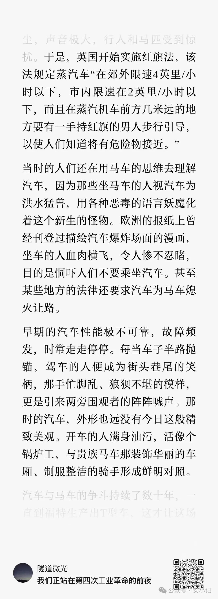
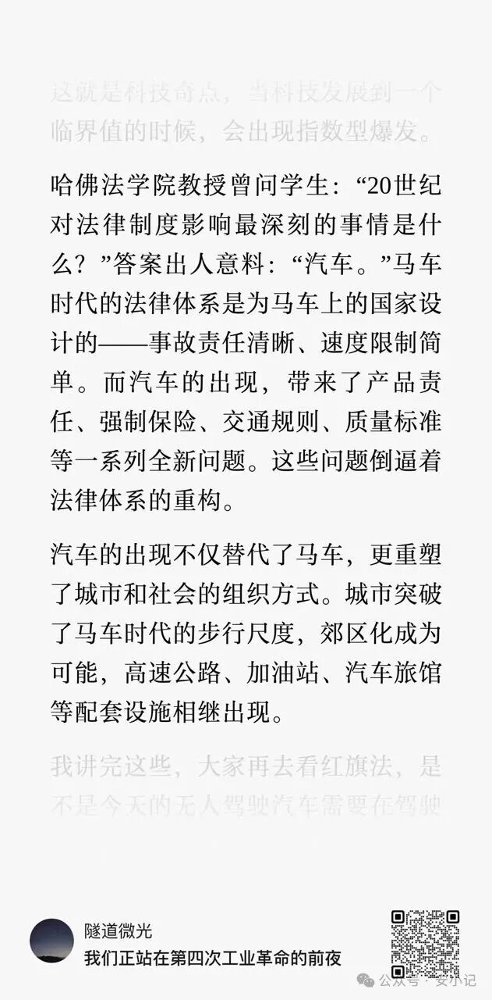
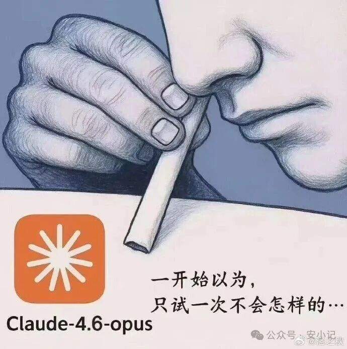
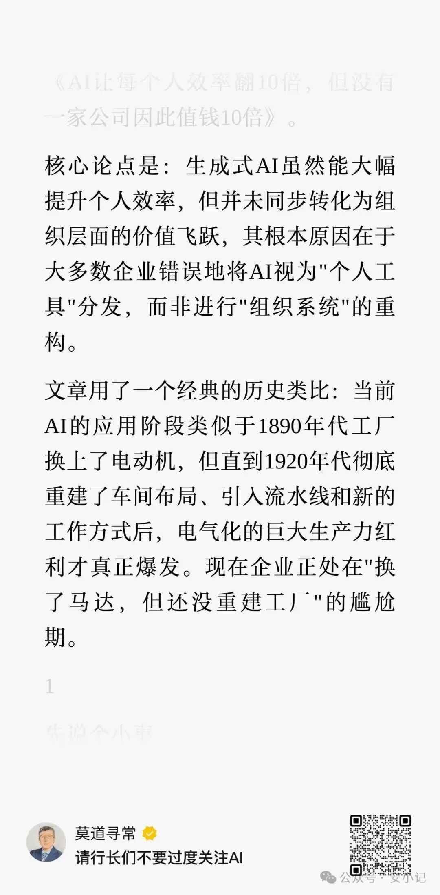

曾经的IT信息技术在摩尔定律统治下，大概2～3年发生一次技术迭代，刚毕业那会，服务是一台一台部署的，代码是一行一行写的，命令也是一行一行敲的，即使是这样在那个时代也是全行业里面技术迭代更新最快的。那时候就很焦虑一不小心就跟不上技术发展。可如今AI时代，技术迭代更是以季度来衡量的，已经不是「跟不跟的上」的问题，而是「学不学的」的问题了，学的慢或者不学甚至就可以不用学了，因为下个月就可能会有新的技术替代现有的。


AI的技术迭代已远超我们的传统认知范围了，谁也不敢保证下个月会不会出一个能力爆表的模型，又或者会出现突然冒出「harness」「loop」这种晦涩难懂的新名词。

* * *

(一)

最近一年来无人驾驶出租车开始进入视野，以「小马智行」见的最多，这种无人驾驶的车辆会挂着一张白色底的车牌，驾驶座上没有司机，取而代之的是挡风玻璃前多一个液晶点阵图，点阵图上面画着一个笑脸，写着「无人驾驶运行中」字样。

时常在路上看着这种车在路上行驶，驾驶座上却看不见司机，有点瘆人。

(二)

那天同事把华为堡垒机web控制台给日了，把chrome+cdp 接入了claude code，随着提示词输入，命令自动stdin/stdout，于是屏幕就哗啦哗啦跑起来了。

想象着，要是晚上办公室黑漆漆只开着这样的屏幕，没人的电脑前面却哗啦刷着屏幕，妥妥恐怖片场景，有点害怕。

(三)

很多夜深人静vibe coding的夜里，输入提示词，看着AI Agent跳出的一个个问答、一段段代码，会突然有一种恍惚，很难想象面前的这台机器居然能够那么神奇的就理解了我的需求，蹦出我想要的代码实现，而背后的却只是一堆堆符号的概率权重，那种感觉很不可思议，却又真实的发生了。

* * *

## 定式思维

车是要司机开的，没人在驾驶座的汽车动了，不符合直觉，所以瘆人；

屏幕上的命令是要人敲的，没人在电脑前面却出现打字，不符合直觉，所以害怕;

电脑那个Agent能够理解你的想法，能够感受你的感受，并能够精确反馈给你，不符合直觉，所以不可思议；

这都是定式思维在作怪。

传统的思维，开车就一定要有司机，终端在输命令就一定要有人屏幕面前敲键盘，而懂你不可能是背后那一对字符权重，过去的经验告诉你这些都是不是正常发生的事情。

```markdown
**定势思维**（Mental Set），在心理学上也常被称为**思维定势**或**心向**，
简单来说，就是大脑为了“偷懒”或追求效率，习惯性地沿用过去的经验、规则或模式
来解决当前问题的一种心理倾向。 --QinWen
```

但在AI时代，以前不可能的事情现在就出现在现实了。要想跟上日新月异的AI时代，首先需要革新自身的认知，不要被以往认知所局限；

有人说AI时代是人类的第四次工业革命，而我们正站在第四次工业革命前夕，就好比20世纪初人们第一见到汽车一样。那时候的人们对汽车这种新事物换成惶恐，可能永远无法相信汽车这个交通工具彻底改变了人类的生产生活，重塑了整个社会。

关于第四次工业革命，非常推荐大家看这篇文章:

[https://mp.weixin.qq.com/s/jibkGdC8ry\_amIOZtL2jTw](https://mp.weixin.qq.com/s?__biz=MzA5NzAzMjIxMw==&mid=2651021613&idx=1&sn=ca4e7e2c6216ac6b272c2ffdc556d8af&scene=21#wechat_redirect)

其中让我印象最深刻的是这两段:





用「马车时代」思考模式来思考「汽车社会」，就是一种定式思维，如今的AI时代与「汽车刚刚出现」那个时代极其相同，同样存在很多定式思维。

从我实际体验来看，主要存在以下几种：

### 定式思维一：程序是很难开发的

在AI时代，代码已经不值钱了，一个Agent分分钟钟给你生成一堆的代码，在Token自由之后就不会再有代码焦虑，「开发不再难」之后要学着要用你的Token打磨你贴身的工具；

看到过一个网安领域有一个基于openclaw 的开源的一个工具，只是对openclaw做了一层很浅的封装，但在用户群里面却可以有上百号人，每天都有不同的人向作者反馈运行中的各种问题，有小到一个前端字体大小的调整，大到一个某个配置导致系统无法正常启动。

表面上看这些用户用上了最新的AI 工具在提升效率，但没有意识到他们可以用AI自主去改造这些工具让其更适合自己。

在传统思维里面，开发一个系统，尤其是专业领域内的系统是很费时间和精力的，所以当有一个需求首先是考虑有没有开源方案，一旦有契合自己领域就马上使用，所有功能更新、bug修复都是等着作者来更新。

但，AI时代来了，为什么还要靠项目作者来更新程序？

Token时代，你就是产品设计师、开发、运维，没有人比你更懂你自己的需求，在AI加持下开发程序已经不是什么困难的事情，尤其是代码已经完全开源的情况下。与其苦苦适应程序等着别人来新增功能、修复bug，为什么不学着让程序来适应你自己呢？

说这些没有不尊重开源作者的意思，也没有鼓励用户停止向开源项目贡献代码意思，现在AI之所以能够编程开发全部都是历经几十年开源作者用爱发电后变成语料训练的结果，是全人类的思想结晶。

「开源没死，只是活在另外一个维度，活在AI每个激活参数里。」

现在普通用户可以借助AI能力站在前人肩膀上做出更多更好的程序，完全可以打磨一个工具更好适应自己的工作而是非受制于程序原本的功能；而是这种「程序是很难开发」的定势思维会限制真正的生产力释放。

「人人都是开发者」已然不是一个玩笑了，不再是「人去适应程序」，而是把「程序打磨成个人专属工具」。

当然，一个项目如果不只是停留在demo阶段，也是需要用户有一定的技术基础的，我始终认为作为IT技术人员，即使在AI时代下编程开发能力依然是必不可少的。AI可以守住你的能力的底线，但你个人的编程基础、架构设计能力才决定你能力的天花板。

### 定式思维二：以前的项目快点搞起来

当Token不再焦虑时候，很多需求就接二连三冒出来了，以前不能做的事情好像都可以做了。于是脑洞大开，每天都跟AI聊得不亦乐乎，深陷「vibe coding 不能自拔」；



但，曾经以为只是技术、时间不够而导致不能开展开展的项目，现在还真的有必要落地吗？

就我自己而言，最近几年都沉在DFIR领域，公众号也曾经写过好几篇关于veloicraptor。 可以毫不夸张的说，我觉得velociraptor 是网络安全中最贴近企业实战场景的事件响应和调查工具，其社区、组件、生态相当完善，除了那简陋的前端页面以外，我几乎给满分；

AI出来以后，第一时间就是想着：“终于有办法解决这个前端顽疾，AI帮我搞定我最菜的前端页面”，于是哗啦哗啦一顿输出。 当代码能力这个鸿沟被跨过之后，改起来也是随心所欲，效果页面抽卡一抽就抽好几张，一周可以重构好几次，没事，开几个分支，那个好看的分支合并哪支。也忙着优化api、封装mcp、做skill，每天都看着曾经不能做的事情都能做下来的时候，那时候只想大喊一声：AI牛逼！

直到有一天，我把堡垒机也skill化了，封装了执行命令和上传下载能力，再接入Agent，在Agent指挥下完成一次完整的事件调查流程，甚至还直接给出了完整的溯源报告，全程没有velociraptor参与。那时的我，突然意识到velociraptor 那套基于 Artifacts VQL 的最佳实践在AI时代是否还真的有用。那个曾经让我奋斗了几年的velociraptor在一霎那间，似乎也没有那么重要了。

velociraptor足够好用是基于一个隐含前提:「给每个调查场景写调查脚本太慢了，而且环境差异极大，需要固化沉淀常用的方法论以提升调查效率」；但在AI时代，这个前提不成立了，AI能够实时推理、快速生成命令、快速获取解析结果、持续调整调查方向、并不断尝试，直到达成目标。命令+文件比Artifacts VQL 更高效直接，为何还要绕一个圈让AI学习Artifacts定义与VQL语法来完成本该就一个脚本就可以完成的事情呢？

我之前一顿重构是否还有意义吗？曾经隐含前提的「问题」已经不存在了，所以还有必要解决去解决「问题」的必要吗？

那些以前还悬而未决的项目，在AI时代开始前先想想，曾经非AI时代的那个问题现在还存在吗。

### 定式思维三：AI是危险的

AI最反直觉的是，AI能够「决策」，这是以往人类从未有的事情，人造物居然具备一种「决策」的能力，尤其是当前AI具备泛化决策。于是人们尝试把AI放在原来需要人决策的位置上，把「人的流程」和「AI的流程」混为一谈，模糊两者边界，一旦发生问题，就把锅狠狠扣在AI上，说AI是危险的。

AI是工具，就好比汽车一样，有汽车扩展人活动范围，但一样会有车祸，但不能把车祸的全怪罪在AI身上，车是人控制的，所以人才是责任主体；即使当前无人驾驶出现车祸也应该是背后的那个运营公司担责，因为没有做好监控汽车的运行状态导致车祸（狭义比喻，不是很准确，理解意思即可）；

AI替人类把事情做了，但这些事是由谁来安排做，就是对应的责任方的。工具无所谓好坏，只有使用的人好坏。

现在的情况下，AI一旦犯错就会被人揪着不放，今天说那个AI删了用户文档，明天又说AI做了什么蠢事。 而发生这是操作事故真正应该反思的是这些AI使用者，是否给AI的权限太大了，是否有兜底的措施等等；

我不否认AI会出错，但一味放大AI错误没有意义，说的好像人就不会犯错一样，以前没有AI的时候也有听说有些运维不小心删库跑路的。作为碳基生物都有可能犯错，为什么作为硅基物体就不能犯错呢？是不是太双标了。

写死的脚本永远不会犯错，但也永远不会进步。强哥说过「浪越大，鱼越贵」，风险多大，收益就多高，又想要收益又想不要风险，是不可能的。用AI可能会带来风险，但也可以获得更高的收益，关键在于AI使用者是否真正去衡量这个投资收益比。

回到前面说的，让AI接管流程固然存在风险的，但把AI放到流程上的这个人应该承担责任，同时也该获得AI带来的收益。人作为主体应该具备权衡风险和收益判断的能力，哪里该AI决策、哪里该人来决策，边界要清晰。本该人来的决策的节点交给AI了，就会无限放大风险，本该AI来决策的由人来决策，就无限拉低效率。

权衡风险收益，才是AI王道。

#### 定式思维四：AI是万能的

严格来说，这不是定式思维，而是过分乐观与盲目自信。

有一篇文章叫 「请行长不要过分关注AI」里面有一段话是这样写的：



原文可以看这里：[https://mp.weixin.qq.com/s/yYI8z\_xU65v68eL2VeySMA](https://mp.weixin.qq.com/s?__biz=MzA5MjkwODk3Mw==&mid=2650460066&idx=1&sn=98967f981f2b819b5e6fe5f92b084a0a&scene=21#wechat_redirect)

AI时代，出门聊天不说点chatgpt antiropic claude code 都不好意思跟人打招呼。企业内部更甚，全员AI，不管你用不用，甚至每周「智慧表格」功能要用多少次都会成为考核这种诡异的事情；

「当一个指标变成考核指标的时候，这个指标就不再是好用的指标」 这句话如龙贯耳。

当AI成为一个指标，「为了AI而AI」时，那不是在「紧跟时代浪潮」，而是在「时代浪潮中溺水」。

所以，老板们，各位决策者们，能不能冷静下来好好想一想。

## 总结

困了，不写了。

(全程手敲，除封面外，无AI参与)

---

*本文首发于微信公众号「安小记」，[原文链接](https://mp.weixin.qq.com/s/UxY2HUcZIxtrEGkYWnpZrA)。*
